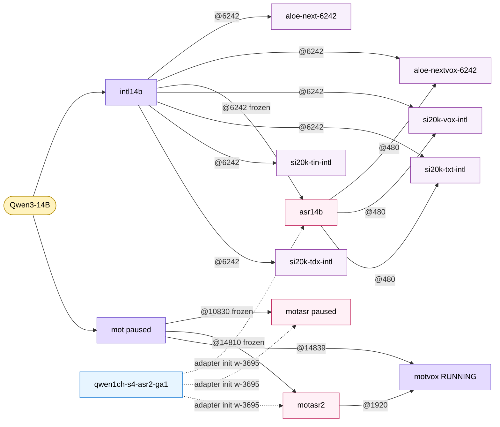
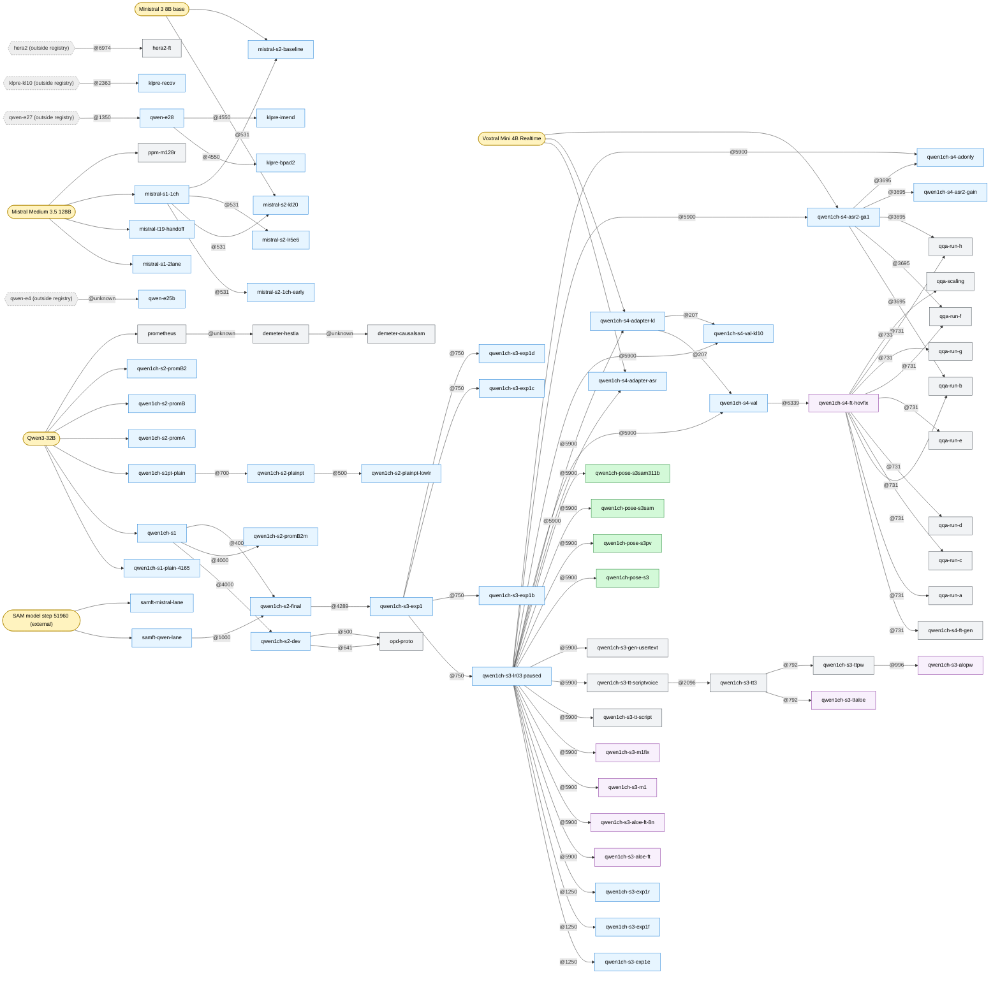
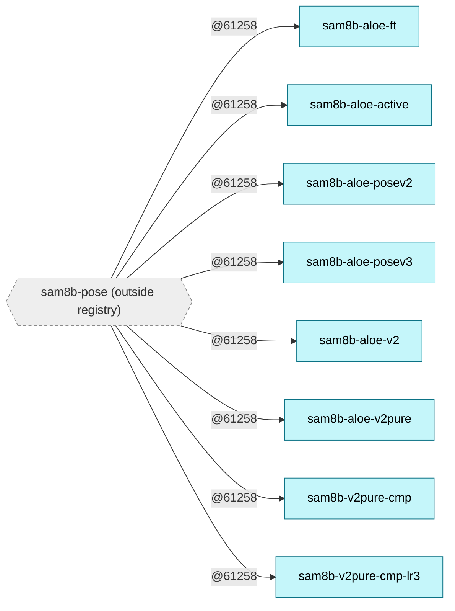

# Model lineage

As of 2026-10-27 20:14 PT. Built from [runs.json](runs.json) by `sources/build_registry.py`; per-run citations are in [RUNS.md](RUNS.md). Edges go parent -> child and are labelled with the parent checkpoint step (`@16861` = parent's dcp/w-16861). `frozen` = the child trains an adapter on a frozen copy of the parent; dashed edges = adapter initialisation (j19174 w-3695). Red thick border = currently LIVE in a deployment. Colours: yellow base models, blue early stage runs, green 32B pretraining, purple 14B pretraining, pink ASR adapters, orange PPMVOX, cyan pose FTs, lilac speech FTs, grey external/other.

Facts this graph rests on (cited in RUNS.md):

- PPM 32B started from stock Qwen3-32B, not from a stage-2/3 Qwen run or Prometheus (row `early-to-ppm-link`, `ppm32b`).
- Pure PPM ends at dcp-16861; everything after is the 8,1,1 run, which shares run_base `ppm-v1` and the ckpt dir (rows `ppm32b`, `ppm811-*`).
- 8,1,1 job 27653 stopped with save at 17850 (not 18022); pose5 (job 31101) resumed 17850 and paused with a full save at 18098 (rows `ppm811-append3`, `pose5`).
- INTL 14B was resumed past 6242 and stopped at 6982; most 14B FTs use w-6242 (row `intl14b`).
- motvox (running) = MoT dcp-14839 + motasr2 adapter w-1920 (row `motvox`).
- Gemma was never trained here; 'Gemma txtdup' = text-duplex rows generated by Gemma (row `gemma-not-trained`). No run started from pretrained Qwen3-4B / 0.6B weights; '4B'/'0.6B' are randomly initialised towers/decoders (row `small-qwen-notes`).

## 1. Spine (key runs only; 45 nodes)

```mermaid
flowchart LR
    n_base_mistral_medium_3_5_128b(["Mistral Medium 3.5 128B"]):::base
    n_base_qwen3_14b(["Qwen3-14B"]):::base
    n_base_qwen3_32b(["Qwen3-32B"]):::base
    n_base_voxtral_mini_4b_realtime_2602(["Voxtral Mini 4B Realtime"]):::base
    n_aloe_nextvox_6242["aloe-nextvox-6242"]:::spft
    n_aloe_samsep_a16861w480["aloe-samsep-a16861w480"]:::spft
    n_aloe_samsep_vox17127["aloe-samsep-vox17127"]:::spft
    n_aloe_v2vox_raw_w14503["aloe-v2vox-raw-w14503"]:::spft
    n_aloespk_brianna_A["aloespk-brianna-A"]:::spft
    n_aloespk_rosie["aloespk-rosie"]:::spft
    n_asr14b["asr14b"]:::asr
    n_asrppm_811_17850["asrppm-811-17850"]:::asr
    n_asrppm_nonorm["asrppm-nonorm"]:::asr
    n_asrppm_w15973["asrppm-w15973"]:::asr
    n_asrppm_w16861["asrppm-w16861"]:::asr
    n_intl14b["intl14b"]:::pre14
    n_mistral_s1_1ch["mistral-s1-1ch"]:::early
    n_mistral_s2_baseline["mistral-s2-baseline"]:::early
    n_mono17850["mono17850<br/>LIVE: Playground (genweb)"]:::posft
    class n_mono17850 live
    n_mono17850sam["mono17850sam<br/>LIVE: Playground (genweb)"]:::posft
    class n_mono17850sam live
    n_mono8020["mono8020"]:::posft
    n_mot["mot paused"]:::pre14
    n_motasr["motasr paused"]:::asr
    n_motasr2["motasr2"]:::asr
    n_motvox["motvox RUNNING"]:::pre14
    n_pose5["pose5 paused"]:::pre32
    n_poseduplex_v5["poseduplex-v5<br/>LIVE: Playground (genweb), Pose-duplex live demo"]:::posft
    class n_poseduplex_v5 live
    n_ppm14b["ppm14b"]:::pre14
    n_ppm32b["ppm32b"]:::pre32
    n_ppm811_append2["ppm811-append2"]:::pre32
    n_ppm811_append3["ppm811-append3"]:::pre32
    n_ppm811_decay["ppm811-decay"]:::pre32
    n_ppm811_v4["ppm811-v4"]:::pre32
    n_ppmvox_v3["ppmvox-v3"]:::vox
    n_ppmvox_v5["ppmvox-v5"]:::vox
    n_ppmvox_v5b["ppmvox-v5b"]:::vox
    n_qwen1ch_s1["qwen1ch-s1"]:::early
    n_qwen1ch_s2_final["qwen1ch-s2-final"]:::early
    n_qwen1ch_s3_exp1["qwen1ch-s3-exp1"]:::early
    n_qwen1ch_s3_lr03["qwen1ch-s3-lr03 paused"]:::early
    n_qwen1ch_s4_asr2_ga1["qwen1ch-s4-asr2-ga1"]:::early
    n_qwen1ch_s4_ft_hovfix["qwen1ch-s4-ft-hovfix"]:::spft
    n_qwen1ch_s4_val["qwen1ch-s4-val"]:::early
    n_xabi_v2pure_16610["xabi-v2pure-16610"]:::posft
    n_xabi_v2pure_17850["xabi-v2pure-17850<br/>LIVE: Playground (genweb)"]:::posft
    class n_xabi_v2pure_17850 live
    n_base_qwen3_32b --> n_qwen1ch_s1
    n_qwen1ch_s1 -->|"@4000"| n_qwen1ch_s2_final
    n_qwen1ch_s2_final -->|"@4289"| n_qwen1ch_s3_exp1
    n_qwen1ch_s3_exp1 -->|"@750"| n_qwen1ch_s3_lr03
    n_qwen1ch_s3_lr03 -->|"@5900"| n_qwen1ch_s4_val
    n_qwen1ch_s4_val -->|"@6339"| n_qwen1ch_s4_ft_hovfix
    n_qwen1ch_s3_lr03 -->|"@5900"| n_qwen1ch_s4_asr2_ga1
    n_base_voxtral_mini_4b_realtime_2602 --> n_qwen1ch_s4_asr2_ga1
    n_base_mistral_medium_3_5_128b --> n_mistral_s1_1ch
    n_mistral_s1_1ch -->|"@531"| n_mistral_s2_baseline
    n_base_qwen3_32b --> n_ppm32b
    n_ppm32b -->|"@16861"| n_ppm811_v4
    n_ppm811_v4 -->|"@17352"| n_ppm811_append2
    n_ppm811_append2 -->|"@17641"| n_ppm811_append3
    n_ppm811_append3 -->|"@17850"| n_ppm811_decay
    n_ppm811_append3 -->|"@17850"| n_pose5
    n_base_qwen3_14b --> n_ppm14b
    n_base_qwen3_14b --> n_intl14b
    n_intl14b -->|"@6242"| n_aloe_nextvox_6242
    n_asr14b -->|"@480"| n_aloe_nextvox_6242
    n_intl14b -->|"@6242 frozen"| n_asr14b
    n_qwen1ch_s4_asr2_ga1 -.->|"adapter init w-3695"| n_asr14b
    n_base_qwen3_14b --> n_mot
    n_mot -->|"@10830 frozen"| n_motasr
    n_qwen1ch_s4_asr2_ga1 -.->|"adapter init w-3695"| n_motasr
    n_mot -->|"@14810 frozen"| n_motasr2
    n_qwen1ch_s4_asr2_ga1 -.->|"adapter init w-3695"| n_motasr2
    n_mot -->|"@14839"| n_motvox
    n_motasr2 -->|"@1920"| n_motvox
    n_ppm32b -->|"@16861"| n_ppmvox_v3
    n_asrppm_w16861 -->|"@16861"| n_ppmvox_v3
    n_base_voxtral_mini_4b_realtime_2602 --> n_ppmvox_v3
    n_ppm811_append3 -->|"@17850"| n_ppmvox_v5
    n_asrppm_811_17850 -->|"@17850"| n_ppmvox_v5
    n_base_voxtral_mini_4b_realtime_2602 --> n_ppmvox_v5
    n_ppmvox_v5 -->|"@18100"| n_ppmvox_v5b
    n_ppm32b -->|"@11488 frozen"| n_asrppm_nonorm
    n_base_voxtral_mini_4b_realtime_2602 --> n_asrppm_nonorm
    n_qwen1ch_s4_asr2_ga1 -.->|"adapter init w-3695"| n_asrppm_nonorm
    n_ppm32b -->|"@15973 frozen"| n_asrppm_w15973
    n_base_voxtral_mini_4b_realtime_2602 --> n_asrppm_w15973
    n_ppm32b -->|"@16861 frozen"| n_asrppm_w16861
    n_base_voxtral_mini_4b_realtime_2602 --> n_asrppm_w16861
    n_qwen1ch_s4_asr2_ga1 -.->|"adapter init w-3695"| n_asrppm_w16861
    n_ppm811_append3 -->|"@17850 frozen"| n_asrppm_811_17850
    n_base_voxtral_mini_4b_realtime_2602 --> n_asrppm_811_17850
    n_qwen1ch_s4_asr2_ga1 -.->|"adapter init w-3695"| n_asrppm_811_17850
    n_ppm32b -->|"@14503"| n_aloe_v2vox_raw_w14503
    n_asrppm_nonorm -->|"@11488"| n_aloe_v2vox_raw_w14503
    n_ppm32b -->|"@16861"| n_aloe_samsep_a16861w480
    n_asrppm_w16861 -->|"@16861-w480"| n_aloe_samsep_a16861w480
    n_ppmvox_v3 -->|"@17127"| n_aloe_samsep_vox17127
    n_aloe_samsep_vox17127 -->|"@249"| n_aloespk_brianna_A
    n_aloe_samsep_vox17127 -->|"@249"| n_aloespk_rosie
    n_ppm32b -->|"@16610"| n_xabi_v2pure_16610
    n_ppm811_append3 -->|"@17850"| n_xabi_v2pure_17850
    n_ppm32b -->|"@11488"| n_mono8020
    n_ppm811_append3 -->|"@17850"| n_mono17850
    n_ppm811_append3 -->|"@17850"| n_mono17850sam
    n_ppmvox_v5 -->|"@18100"| n_poseduplex_v5
    classDef base fill:#fff3bf,stroke:#b08800,color:#000
    classDef ext fill:#eeeeee,stroke:#888,color:#333,stroke-dasharray:4 3
    classDef early fill:#e7f5ff,stroke:#1c7ed6,color:#000
    classDef pre32 fill:#d3f9d8,stroke:#2b8a3e,color:#000
    classDef pre14 fill:#e5dbff,stroke:#5f3dc4,color:#000
    classDef asr fill:#fff0f6,stroke:#c2255c,color:#000
    classDef vox fill:#ffe8cc,stroke:#d9480f,color:#000
    classDef posft fill:#c5f6fa,stroke:#0b7285,color:#000
    classDef spft fill:#f8f0fc,stroke:#862e9c,color:#000
    classDef other fill:#f1f3f5,stroke:#495057,color:#000
    classDef live stroke:#e03131,stroke-width:4px
```



## 2. 32B pretraining line and every 32B fine-tune branch (77 nodes, 110 edges)

```mermaid
flowchart LR
    n_base_qwen3_32b(["Qwen3-32B"]):::base
    n_base_voxtral_mini_4b_realtime_2602(["Voxtral Mini 4B Realtime"]):::base
    n_aloe_ft_21980["aloe-ft-21980"]:::spft
    n_aloe_m1vox_ft["aloe-m1vox-ft"]:::spft
    n_aloe_nopose_ft["aloe-nopose-ft"]:::posft
    n_aloe_pose_ft["aloe-pose-ft"]:::posft
    n_aloe_pose_rosie["aloe-pose-rosie"]:::posft
    n_aloe_samsep_16861["aloe-samsep-16861"]:::spft
    n_aloe_samsep_a16861w480["aloe-samsep-a16861w480"]:::spft
    n_aloe_samsep_vox17127["aloe-samsep-vox17127"]:::spft
    n_aloe_samsep_vox17127_persona["aloe-samsep-vox17127-persona"]:::spft
    n_aloe_uncond_ft["aloe-uncond-ft"]:::posft
    n_aloe_v2_ft["aloe-v2-ft"]:::spft
    n_aloe_v2init_10351["aloe-v2init-10351"]:::spft
    n_aloe_v2init_12529["aloe-v2init-12529"]:::spft
    n_aloe_v2init_8869["aloe-v2init-8869"]:::spft
    n_aloe_v2vox_asr_w15973["aloe-v2vox-asr-w15973"]:::spft
    n_aloe_v2vox_asr_w15973_textB["aloe-v2vox-asr-w15973-textB"]:::spft
    n_aloe_v2vox_ft["aloe-v2vox-ft"]:::spft
    n_aloe_v2vox_raw["aloe-v2vox-raw"]:::spft
    n_aloe_v2vox_raw_w14503["aloe-v2vox-raw-w14503"]:::spft
    n_aloe_vox_ft["aloe-vox-ft"]:::spft
    n_aloe_voxall_ft["aloe-voxall-ft"]:::spft
    n_aloe_zoom_cotrain["aloe-zoom-cotrain"]:::spft
    n_aloespk_brianna_A["aloespk-brianna-A"]:::spft
    n_aloespk_brianna_B["aloespk-brianna-B"]:::spft
    n_aloespk_brianna_B2["aloespk-brianna-B2"]:::spft
    n_aloespk_rosie["aloespk-rosie"]:::spft
    n_asr14b["asr14b"]:::asr
    n_asrppm_811_17850["asrppm-811-17850"]:::asr
    n_asrppm_nonorm["asrppm-nonorm"]:::asr
    n_asrppm_rmsnorm_11488["asrppm-rmsnorm-11488"]:::asr
    n_asrppm_w15973["asrppm-w15973"]:::asr
    n_asrppm_w16861["asrppm-w16861"]:::asr
    n_intl14b["intl14b"]:::pre14
    n_mono17850["mono17850<br/>LIVE: Playground (genweb)"]:::posft
    class n_mono17850 live
    n_mono17850sam["mono17850sam<br/>LIVE: Playground (genweb)"]:::posft
    class n_mono17850sam live
    n_mono8020["mono8020"]:::posft
    n_mono8020_sam["mono8020-sam"]:::posft
    n_pose5["pose5 paused"]:::pre32
    n_poseduplex_v5["poseduplex-v5<br/>LIVE: Playground (genweb), Pose-duplex live demo"]:::posft
    class n_poseduplex_v5 live
    n_ppm_linkexp_a["ppm-linkexp-a"]:::pre32
    n_ppm32b["ppm32b"]:::pre32
    n_ppm811_append2["ppm811-append2"]:::pre32
    n_ppm811_append3["ppm811-append3"]:::pre32
    n_ppm811_decay["ppm811-decay"]:::pre32
    n_ppm811_epoch2["ppm811-epoch2"]:::pre32
    n_ppm811_falsestarts["ppm811-falsestarts"]:::pre32
    n_ppm811_v4["ppm811-v4"]:::pre32
    n_ppmvox_v1["ppmvox-v1"]:::vox
    n_ppmvox_v2["ppmvox-v2"]:::vox
    n_ppmvox_v3["ppmvox-v3"]:::vox
    n_ppmvox_v3x["ppmvox-v3x"]:::vox
    n_ppmvox_v5["ppmvox-v5"]:::vox
    n_ppmvox_v5b["ppmvox-v5b"]:::vox
    n_qqa_ft["qqa-ft"]:::other
    n_qwen1ch_s4_asr2_ga1["qwen1ch-s4-asr2-ga1"]:::early
    n_si20k_tdx_intl["si20k-tdx-intl"]:::spft
    n_si20k_tin_intl["si20k-tin-intl"]:::spft
    n_si20k_tin_ppm["si20k-tin-ppm"]:::spft
    n_si20k_txt_intl["si20k-txt-intl"]:::spft
    n_si20k_txt_ppm["si20k-txt-ppm"]:::spft
    n_si20k_vox_intl["si20k-vox-intl"]:::spft
    n_si20k_vox_ppm["si20k-vox-ppm"]:::spft
    n_si20k_vox_ppm_nocorrupt["si20k-vox-ppm-nocorrupt"]:::spft
    n_si20k_vox_ppm11488["si20k-vox-ppm11488"]:::spft
    n_ttconvo_ft["ttconvo-ft"]:::other
    n_xabi_v2pure_11488["xabi-v2pure-11488"]:::posft
    n_xabi_v2pure_13533["xabi-v2pure-13533"]:::posft
    n_xabi_v2pure_16610["xabi-v2pure-16610"]:::posft
    n_xabi_v2pure_17352["xabi-v2pure-17352"]:::posft
    n_xabi_v2pure_17641["xabi-v2pure-17641"]:::posft
    n_xabi_v2pure_17850["xabi-v2pure-17850<br/>LIVE: Playground (genweb)"]:::posft
    class n_xabi_v2pure_17850 live
    n_xabi_v2pure_7932["xabi-v2pure-7932"]:::posft
    n_xabi_v2pure_clip80["xabi-v2pure-clip80"]:::posft
    n_xfer_none_ss["xfer-none-ss"]:::spft
    n_xfer_tt_ss["xfer-tt-ss"]:::spft
    n_base_voxtral_mini_4b_realtime_2602 --> n_qwen1ch_s4_asr2_ga1
    n_base_qwen3_32b --> n_ppm32b
    n_ppm32b -->|"@16762"| n_ppm_linkexp_a
    n_ppm32b -->|"@16861"| n_ppm811_epoch2
    n_ppm32b -->|"@16861"| n_ppm811_falsestarts
    n_ppm32b -->|"@16861"| n_ppm811_v4
    n_ppm811_v4 -->|"@17352"| n_ppm811_append2
    n_ppm811_append2 -->|"@17641"| n_ppm811_append3
    n_ppm811_append3 -->|"@17850"| n_ppm811_decay
    n_ppm811_append3 -->|"@17850"| n_pose5
    n_intl14b -->|"@6242 frozen"| n_asr14b
    n_qwen1ch_s4_asr2_ga1 -.->|"adapter init w-3695"| n_asr14b
    n_ppm32b -->|"@16861"| n_ppmvox_v1
    n_asrppm_w16861 -->|"@16861-w840"| n_ppmvox_v1
    n_base_voxtral_mini_4b_realtime_2602 --> n_ppmvox_v1
    n_ppm32b -->|"@16861"| n_ppmvox_v2
    n_asrppm_w16861 -->|"@16861"| n_ppmvox_v2
    n_ppm32b -->|"@16861"| n_ppmvox_v3
    n_asrppm_w16861 -->|"@16861"| n_ppmvox_v3
    n_base_voxtral_mini_4b_realtime_2602 --> n_ppmvox_v3
    n_ppmvox_v3 -->|"@17127"| n_ppmvox_v3x
    n_ppm811_append3 -->|"@17850"| n_ppmvox_v5
    n_asrppm_811_17850 -->|"@17850"| n_ppmvox_v5
    n_base_voxtral_mini_4b_realtime_2602 --> n_ppmvox_v5
    n_ppmvox_v5 -->|"@18100"| n_ppmvox_v5b
    n_ppm32b -->|"@11488 frozen"| n_asrppm_rmsnorm_11488
    n_base_voxtral_mini_4b_realtime_2602 --> n_asrppm_rmsnorm_11488
    n_qwen1ch_s4_asr2_ga1 -.->|"adapter init w-3695"| n_asrppm_rmsnorm_11488
    n_ppm32b -->|"@11488 frozen"| n_asrppm_nonorm
    n_base_voxtral_mini_4b_realtime_2602 --> n_asrppm_nonorm
    n_qwen1ch_s4_asr2_ga1 -.->|"adapter init w-3695"| n_asrppm_nonorm
    n_ppm32b -->|"@15973 frozen"| n_asrppm_w15973
    n_base_voxtral_mini_4b_realtime_2602 --> n_asrppm_w15973
    n_ppm32b -->|"@16861 frozen"| n_asrppm_w16861
    n_base_voxtral_mini_4b_realtime_2602 --> n_asrppm_w16861
    n_qwen1ch_s4_asr2_ga1 -.->|"adapter init w-3695"| n_asrppm_w16861
    n_ppm811_append3 -->|"@17850 frozen"| n_asrppm_811_17850
    n_base_voxtral_mini_4b_realtime_2602 --> n_asrppm_811_17850
    n_qwen1ch_s4_asr2_ga1 -.->|"adapter init w-3695"| n_asrppm_811_17850
    n_ppm32b -->|"@11488"| n_aloe_ft_21980
    n_ppm32b -->|"@11488"| n_aloe_nopose_ft
    n_ppm32b -->|"@11488"| n_aloe_uncond_ft
    n_ppm32b -->|"@12465"| n_aloe_vox_ft
    n_asrppm_nonorm -->|"@11488"| n_aloe_vox_ft
    n_ppm32b -->|"@12465"| n_aloe_voxall_ft
    n_asrppm_nonorm -->|"@11488"| n_aloe_voxall_ft
    n_ppm32b -->|"@11488"| n_aloe_m1vox_ft
    n_asrppm_nonorm -->|"@11488"| n_aloe_m1vox_ft
    n_ppm32b -->|"@11488"| n_aloe_v2_ft
    n_ppm32b -->|"@11488"| n_aloe_v2vox_ft
    n_asrppm_nonorm -->|"@11488"| n_aloe_v2vox_ft
    n_ppm32b -->|"@11488"| n_aloe_v2vox_raw
    n_asrppm_nonorm -->|"@11488"| n_aloe_v2vox_raw
    n_ppm32b -->|"@14503"| n_aloe_v2vox_raw_w14503
    n_asrppm_nonorm -->|"@11488"| n_aloe_v2vox_raw_w14503
    n_ppm32b -->|"@15973"| n_aloe_v2vox_asr_w15973
    n_asrppm_w15973 -->|"@15973"| n_aloe_v2vox_asr_w15973
    n_ppm32b -->|"@15973"| n_aloe_v2vox_asr_w15973_textB
    n_asrppm_w15973 -->|"@15973"| n_aloe_v2vox_asr_w15973_textB
    n_ppm32b -->|"@15973"| n_aloe_zoom_cotrain
    n_asrppm_w15973 -->|"@15973"| n_aloe_zoom_cotrain
    n_ppm32b -->|"@16861"| n_aloe_samsep_16861
    n_asrppm_w15973 -->|"@15973"| n_aloe_samsep_16861
    n_ppm32b -->|"@16861"| n_aloe_samsep_a16861w480
    n_asrppm_w16861 -->|"@16861-w480"| n_aloe_samsep_a16861w480
    n_ppmvox_v3 -->|"@17127"| n_aloe_samsep_vox17127
    n_ppmvox_v3 -->|"@17127"| n_aloe_samsep_vox17127_persona
    n_aloe_samsep_vox17127 -->|"@249"| n_aloespk_brianna_A
    n_aloe_samsep_vox17127 -->|"@249"| n_aloespk_brianna_B
    n_aloe_samsep_vox17127 -->|"@249"| n_aloespk_brianna_B2
    n_aloe_samsep_vox17127 -->|"@249"| n_aloespk_rosie
    n_ppm32b -->|"@11263"| n_qqa_ft
    n_ppm811_epoch2 -->|"@17012"| n_ttconvo_ft
    n_ppm32b -->|"@12829"| n_si20k_vox_ppm
    n_asrppm_nonorm -->|"@11488"| n_si20k_vox_ppm
    n_intl14b -->|"@6242"| n_si20k_vox_intl
    n_asr14b -->|"@480"| n_si20k_vox_intl
    n_ppm32b -->|"@12829"| n_si20k_txt_ppm
    n_asrppm_nonorm -->|"@11488"| n_si20k_txt_ppm
    n_intl14b -->|"@6242"| n_si20k_txt_intl
    n_asr14b -->|"@480"| n_si20k_txt_intl
    n_ppm32b -->|"@12829"| n_si20k_tin_ppm
    n_intl14b -->|"@6242"| n_si20k_tin_intl
    n_intl14b -->|"@6242"| n_si20k_tdx_intl
    n_ppm32b -->|"@11488"| n_si20k_vox_ppm11488
    n_asrppm_nonorm -->|"@11488"| n_si20k_vox_ppm11488
    n_ppm32b -->|"@12829"| n_si20k_vox_ppm_nocorrupt
    n_asrppm_nonorm -->|"@11488"| n_si20k_vox_ppm_nocorrupt
    n_ppm32b -->|"@12829"| n_xfer_tt_ss
    n_asrppm_nonorm -->|"@11488"| n_xfer_tt_ss
    n_ppm32b -->|"@12829"| n_xfer_none_ss
    n_asrppm_nonorm -->|"@11488"| n_xfer_none_ss
    n_ppm32b -->|"@7932"| n_xabi_v2pure_7932
    n_ppm32b -->|"@11488"| n_xabi_v2pure_11488
    n_ppm32b -->|"@13533"| n_xabi_v2pure_13533
    n_ppm32b -->|"@16610"| n_xabi_v2pure_16610
    n_ppm811_v4 -->|"@17352"| n_xabi_v2pure_17352
    n_ppm811_append2 -->|"@17641"| n_xabi_v2pure_17641
    n_ppm811_append3 -->|"@17850"| n_xabi_v2pure_17850
    n_ppm32b -->|"@11488"| n_xabi_v2pure_clip80
    n_ppm32b -->|"@11488"| n_aloe_pose_ft
    n_ppm32b -->|"@11488"| n_mono8020
    n_ppm32b -->|"@11488"| n_mono8020_sam
    n_ppm811_append3 -->|"@17850"| n_mono17850
    n_ppm811_append3 -->|"@17850"| n_mono17850sam
    n_mono8020 -->|"@357"| n_aloe_pose_rosie
    n_ppmvox_v5 -->|"@18100"| n_poseduplex_v5
    n_ppm32b -->|"@8869"| n_aloe_v2init_8869
    n_ppm32b -->|"@10351"| n_aloe_v2init_10351
    n_ppm32b -->|"@12529"| n_aloe_v2init_12529
    classDef base fill:#fff3bf,stroke:#b08800,color:#000
    classDef ext fill:#eeeeee,stroke:#888,color:#333,stroke-dasharray:4 3
    classDef early fill:#e7f5ff,stroke:#1c7ed6,color:#000
    classDef pre32 fill:#d3f9d8,stroke:#2b8a3e,color:#000
    classDef pre14 fill:#e5dbff,stroke:#5f3dc4,color:#000
    classDef asr fill:#fff0f6,stroke:#c2255c,color:#000
    classDef vox fill:#ffe8cc,stroke:#d9480f,color:#000
    classDef posft fill:#c5f6fa,stroke:#0b7285,color:#000
    classDef spft fill:#f8f0fc,stroke:#862e9c,color:#000
    classDef other fill:#f1f3f5,stroke:#495057,color:#000
    classDef live stroke:#e03131,stroke-width:4px
```



## 3. 14B family (INTL 14B, ppm14b, MoT, motvox, adapters, FTs) (14 nodes, 19 edges)



## 4. Early Qwen / Mistral stage runs and reference runs (81 nodes, 85 edges)



## 5. SAM 8B pose fine-tunes (external base) (9 nodes, 8 edges)



## 6. Complete graph (172 nodes, 214 edges)

Every run row, base model and external parent in one graph (large; the family graphs above are easier to read).

```mermaid
flowchart LR
    n_base_ministral_3_8b_base_2512(["Ministral 3 8B base"]):::base
    n_base_mistral_medium_3_5_128b(["Mistral Medium 3.5 128B"]):::base
    n_base_qwen3_14b(["Qwen3-14B"]):::base
    n_base_qwen3_32b(["Qwen3-32B"]):::base
    n_base_sam_51960(["SAM model step 51960 (external)"]):::base
    n_base_voxtral_mini_4b_realtime_2602(["Voxtral Mini 4B Realtime"]):::base
    n_aloe_ft_21980["aloe-ft-21980"]:::spft
    n_aloe_m1vox_ft["aloe-m1vox-ft"]:::spft
    n_aloe_next_6242["aloe-next-6242"]:::spft
    n_aloe_nextvox_6242["aloe-nextvox-6242"]:::spft
    n_aloe_nopose_ft["aloe-nopose-ft"]:::posft
    n_aloe_pose_ft["aloe-pose-ft"]:::posft
    n_aloe_pose_rosie["aloe-pose-rosie"]:::posft
    n_aloe_samsep_16861["aloe-samsep-16861"]:::spft
    n_aloe_samsep_a16861w480["aloe-samsep-a16861w480"]:::spft
    n_aloe_samsep_vox17127["aloe-samsep-vox17127"]:::spft
    n_aloe_samsep_vox17127_persona["aloe-samsep-vox17127-persona"]:::spft
    n_aloe_uncond_ft["aloe-uncond-ft"]:::posft
    n_aloe_v2_ft["aloe-v2-ft"]:::spft
    n_aloe_v2init_10351["aloe-v2init-10351"]:::spft
    n_aloe_v2init_12529["aloe-v2init-12529"]:::spft
    n_aloe_v2init_8869["aloe-v2init-8869"]:::spft
    n_aloe_v2vox_asr_w15973["aloe-v2vox-asr-w15973"]:::spft
    n_aloe_v2vox_asr_w15973_textB["aloe-v2vox-asr-w15973-textB"]:::spft
    n_aloe_v2vox_ft["aloe-v2vox-ft"]:::spft
    n_aloe_v2vox_raw["aloe-v2vox-raw"]:::spft
    n_aloe_v2vox_raw_w14503["aloe-v2vox-raw-w14503"]:::spft
    n_aloe_vox_ft["aloe-vox-ft"]:::spft
    n_aloe_voxall_ft["aloe-voxall-ft"]:::spft
    n_aloe_zoom_cotrain["aloe-zoom-cotrain"]:::spft
    n_aloespk_brianna_A["aloespk-brianna-A"]:::spft
    n_aloespk_brianna_B["aloespk-brianna-B"]:::spft
    n_aloespk_brianna_B2["aloespk-brianna-B2"]:::spft
    n_aloespk_rosie["aloespk-rosie"]:::spft
    n_asr14b["asr14b"]:::asr
    n_asrppm_811_17850["asrppm-811-17850"]:::asr
    n_asrppm_nonorm["asrppm-nonorm"]:::asr
    n_asrppm_rmsnorm_11488["asrppm-rmsnorm-11488"]:::asr
    n_asrppm_w15973["asrppm-w15973"]:::asr
    n_asrppm_w16861["asrppm-w16861"]:::asr
    n_demeter_causalsam["demeter-causalsam"]:::other
    n_demeter_hestia["demeter-hestia"]:::other
    n_ext_hera2{{"hera2 (outside registry)"}}:::ext
    n_ext_klpre_kl10{{"klpre-kl10 (outside registry)"}}:::ext
    n_ext_qwen_e27{{"qwen-e27 (outside registry)"}}:::ext
    n_ext_qwen_e4{{"qwen-e4 (outside registry)"}}:::ext
    n_ext_sam8b_pose{{"sam8b-pose (outside registry)"}}:::ext
    n_hera2_ft["hera2-ft"]:::other
    n_intl14b["intl14b"]:::pre14
    n_klpre_bpad2["klpre-bpad2"]:::early
    n_klpre_imend["klpre-imend"]:::early
    n_klpre_recov["klpre-recov"]:::early
    n_mistral_s1_1ch["mistral-s1-1ch"]:::early
    n_mistral_s1_2lane["mistral-s1-2lane"]:::early
    n_mistral_s2_1ch_early["mistral-s2-1ch-early"]:::early
    n_mistral_s2_baseline["mistral-s2-baseline"]:::early
    n_mistral_s2_kl20["mistral-s2-kl20"]:::early
    n_mistral_s2_lr5e6["mistral-s2-lr5e6"]:::early
    n_mistral_t19_handoff["mistral-t19-handoff"]:::early
    n_mono17850["mono17850<br/>LIVE: Playground (genweb)"]:::posft
    class n_mono17850 live
    n_mono17850sam["mono17850sam<br/>LIVE: Playground (genweb)"]:::posft
    class n_mono17850sam live
    n_mono8020["mono8020"]:::posft
    n_mono8020_sam["mono8020-sam"]:::posft
    n_mot["mot paused"]:::pre14
    n_motasr["motasr paused"]:::asr
    n_motasr2["motasr2"]:::asr
    n_motvox["motvox RUNNING"]:::pre14
    n_opd_proto["opd-proto"]:::other
    n_pose5["pose5 paused"]:::pre32
    n_poseduplex_v5["poseduplex-v5<br/>LIVE: Playground (genweb), Pose-duplex live demo"]:::posft
    class n_poseduplex_v5 live
    n_ppm_linkexp_a["ppm-linkexp-a"]:::pre32
    n_ppm_m128r["ppm-m128r"]:::other
    n_ppm14b["ppm14b"]:::pre14
    n_ppm32b["ppm32b"]:::pre32
    n_ppm811_append2["ppm811-append2"]:::pre32
    n_ppm811_append3["ppm811-append3"]:::pre32
    n_ppm811_decay["ppm811-decay"]:::pre32
    n_ppm811_epoch2["ppm811-epoch2"]:::pre32
    n_ppm811_falsestarts["ppm811-falsestarts"]:::pre32
    n_ppm811_v4["ppm811-v4"]:::pre32
    n_ppmvox_v1["ppmvox-v1"]:::vox
    n_ppmvox_v2["ppmvox-v2"]:::vox
    n_ppmvox_v3["ppmvox-v3"]:::vox
    n_ppmvox_v3x["ppmvox-v3x"]:::vox
    n_ppmvox_v5["ppmvox-v5"]:::vox
    n_ppmvox_v5b["ppmvox-v5b"]:::vox
    n_prometheus["prometheus"]:::other
    n_qqa_ft["qqa-ft"]:::other
    n_qqa_run_a["qqa-run-a"]:::other
    n_qqa_run_b["qqa-run-b"]:::other
    n_qqa_run_c["qqa-run-c"]:::other
    n_qqa_run_d["qqa-run-d"]:::other
    n_qqa_run_e["qqa-run-e"]:::other
    n_qqa_run_f["qqa-run-f"]:::other
    n_qqa_run_g["qqa-run-g"]:::other
    n_qqa_run_h["qqa-run-h"]:::other
    n_qqa_scaling["qqa-scaling"]:::other
    n_qwen_e25b["qwen-e25b"]:::early
    n_qwen_e28["qwen-e28"]:::early
    n_qwen1ch_pose_s3["qwen1ch-pose-s3"]:::pre32
    n_qwen1ch_pose_s3pv["qwen1ch-pose-s3pv"]:::pre32
    n_qwen1ch_pose_s3sam["qwen1ch-pose-s3sam"]:::pre32
    n_qwen1ch_pose_s3sam311b["qwen1ch-pose-s3sam311b"]:::pre32
    n_qwen1ch_s1["qwen1ch-s1"]:::early
    n_qwen1ch_s1_plain_4165["qwen1ch-s1-plain-4165"]:::early
    n_qwen1ch_s1pt_plain["qwen1ch-s1pt-plain"]:::early
    n_qwen1ch_s2_dev["qwen1ch-s2-dev"]:::early
    n_qwen1ch_s2_final["qwen1ch-s2-final"]:::early
    n_qwen1ch_s2_plainpt["qwen1ch-s2-plainpt"]:::early
    n_qwen1ch_s2_plainpt_lowlr["qwen1ch-s2-plainpt-lowlr"]:::early
    n_qwen1ch_s2_promA["qwen1ch-s2-promA"]:::early
    n_qwen1ch_s2_promB["qwen1ch-s2-promB"]:::early
    n_qwen1ch_s2_promB2["qwen1ch-s2-promB2"]:::early
    n_qwen1ch_s2_promB2m["qwen1ch-s2-promB2m"]:::early
    n_qwen1ch_s3_aloe_ft["qwen1ch-s3-aloe-ft"]:::spft
    n_qwen1ch_s3_aloe_ft_8n["qwen1ch-s3-aloe-ft-8n"]:::spft
    n_qwen1ch_s3_alopw["qwen1ch-s3-alopw"]:::spft
    n_qwen1ch_s3_exp1["qwen1ch-s3-exp1"]:::early
    n_qwen1ch_s3_exp1b["qwen1ch-s3-exp1b"]:::early
    n_qwen1ch_s3_exp1c["qwen1ch-s3-exp1c"]:::early
    n_qwen1ch_s3_exp1d["qwen1ch-s3-exp1d"]:::early
    n_qwen1ch_s3_exp1e["qwen1ch-s3-exp1e"]:::early
    n_qwen1ch_s3_exp1f["qwen1ch-s3-exp1f"]:::early
    n_qwen1ch_s3_exp1r["qwen1ch-s3-exp1r"]:::early
    n_qwen1ch_s3_gen_usertext["qwen1ch-s3-gen-usertext"]:::other
    n_qwen1ch_s3_lr03["qwen1ch-s3-lr03 paused"]:::early
    n_qwen1ch_s3_m1["qwen1ch-s3-m1"]:::spft
    n_qwen1ch_s3_m1fix["qwen1ch-s3-m1fix"]:::spft
    n_qwen1ch_s3_tt_script["qwen1ch-s3-tt-script"]:::other
    n_qwen1ch_s3_tt_scriptvoice["qwen1ch-s3-tt-scriptvoice"]:::other
    n_qwen1ch_s3_tt3["qwen1ch-s3-tt3"]:::other
    n_qwen1ch_s3_ttaloe["qwen1ch-s3-ttaloe"]:::spft
    n_qwen1ch_s3_ttpw["qwen1ch-s3-ttpw"]:::other
    n_qwen1ch_s4_adapter_asr["qwen1ch-s4-adapter-asr"]:::early
    n_qwen1ch_s4_adapter_kl["qwen1ch-s4-adapter-kl"]:::early
    n_qwen1ch_s4_adonly["qwen1ch-s4-adonly"]:::early
    n_qwen1ch_s4_asr2_ga1["qwen1ch-s4-asr2-ga1"]:::early
    n_qwen1ch_s4_asr2_gain["qwen1ch-s4-asr2-gain"]:::early
    n_qwen1ch_s4_ft_gen["qwen1ch-s4-ft-gen"]:::other
    n_qwen1ch_s4_ft_hovfix["qwen1ch-s4-ft-hovfix"]:::spft
    n_qwen1ch_s4_val["qwen1ch-s4-val"]:::early
    n_qwen1ch_s4_val_kl10["qwen1ch-s4-val-kl10"]:::early
    n_sam8b_aloe_active["sam8b-aloe-active"]:::posft
    n_sam8b_aloe_ft["sam8b-aloe-ft"]:::posft
    n_sam8b_aloe_posev2["sam8b-aloe-posev2"]:::posft
    n_sam8b_aloe_posev3["sam8b-aloe-posev3"]:::posft
    n_sam8b_aloe_v2["sam8b-aloe-v2"]:::posft
    n_sam8b_aloe_v2pure["sam8b-aloe-v2pure"]:::posft
    n_sam8b_v2pure_cmp["sam8b-v2pure-cmp"]:::posft
    n_sam8b_v2pure_cmp_lr3["sam8b-v2pure-cmp-lr3"]:::posft
    n_samft_mistral_lane["samft-mistral-lane"]:::early
    n_samft_qwen_lane["samft-qwen-lane"]:::early
    n_si20k_tdx_intl["si20k-tdx-intl"]:::spft
    n_si20k_tin_intl["si20k-tin-intl"]:::spft
    n_si20k_tin_ppm["si20k-tin-ppm"]:::spft
    n_si20k_txt_intl["si20k-txt-intl"]:::spft
    n_si20k_txt_ppm["si20k-txt-ppm"]:::spft
    n_si20k_vox_intl["si20k-vox-intl"]:::spft
    n_si20k_vox_ppm["si20k-vox-ppm"]:::spft
    n_si20k_vox_ppm_nocorrupt["si20k-vox-ppm-nocorrupt"]:::spft
    n_si20k_vox_ppm11488["si20k-vox-ppm11488"]:::spft
    n_ttconvo_ft["ttconvo-ft"]:::other
    n_xabi_v2pure_11488["xabi-v2pure-11488"]:::posft
    n_xabi_v2pure_13533["xabi-v2pure-13533"]:::posft
    n_xabi_v2pure_16610["xabi-v2pure-16610"]:::posft
    n_xabi_v2pure_17352["xabi-v2pure-17352"]:::posft
    n_xabi_v2pure_17641["xabi-v2pure-17641"]:::posft
    n_xabi_v2pure_17850["xabi-v2pure-17850<br/>LIVE: Playground (genweb)"]:::posft
    class n_xabi_v2pure_17850 live
    n_xabi_v2pure_7932["xabi-v2pure-7932"]:::posft
    n_xabi_v2pure_clip80["xabi-v2pure-clip80"]:::posft
    n_xfer_none_ss["xfer-none-ss"]:::spft
    n_xfer_tt_ss["xfer-tt-ss"]:::spft
    n_ext_qwen_e4 -->|"@unknown"| n_qwen_e25b
    n_ext_qwen_e27 -->|"@1350"| n_qwen_e28
    n_qwen_e28 -->|"@4550"| n_klpre_bpad2
    n_ext_klpre_kl10 -->|"@2363"| n_klpre_recov
    n_qwen_e28 -->|"@4550"| n_klpre_imend
    n_base_qwen3_32b --> n_qwen1ch_s1_plain_4165
    n_base_qwen3_32b --> n_qwen1ch_s1
    n_base_qwen3_32b --> n_qwen1ch_s1pt_plain
    n_qwen1ch_s1 -->|"@4000"| n_qwen1ch_s2_dev
    n_base_qwen3_32b --> n_qwen1ch_s2_promA
    n_base_qwen3_32b --> n_qwen1ch_s2_promB
    n_base_qwen3_32b --> n_qwen1ch_s2_promB2
    n_qwen1ch_s1 -->|"@4000"| n_qwen1ch_s2_promB2m
    n_base_sam_51960 --> n_samft_qwen_lane
    n_qwen1ch_s1 -->|"@4000"| n_qwen1ch_s2_final
    n_samft_qwen_lane -->|"@1000"| n_qwen1ch_s2_final
    n_qwen1ch_s1pt_plain -->|"@700"| n_qwen1ch_s2_plainpt
    n_qwen1ch_s2_plainpt -->|"@500"| n_qwen1ch_s2_plainpt_lowlr
    n_qwen1ch_s2_dev -->|"@641"| n_opd_proto
    n_qwen1ch_s2_dev -->|"@500"| n_opd_proto
    n_qwen1ch_s2_final -->|"@4289"| n_qwen1ch_s3_exp1
    n_qwen1ch_s3_exp1 -->|"@750"| n_qwen1ch_s3_lr03
    n_qwen1ch_s3_exp1 -->|"@750"| n_qwen1ch_s3_exp1b
    n_qwen1ch_s3_exp1 -->|"@750"| n_qwen1ch_s3_exp1c
    n_qwen1ch_s3_exp1 -->|"@750"| n_qwen1ch_s3_exp1d
    n_qwen1ch_s3_lr03 -->|"@1250"| n_qwen1ch_s3_exp1e
    n_qwen1ch_s3_lr03 -->|"@1250"| n_qwen1ch_s3_exp1f
    n_qwen1ch_s3_lr03 -->|"@1250"| n_qwen1ch_s3_exp1r
    n_qwen1ch_s3_lr03 -->|"@5900"| n_qwen1ch_s3_aloe_ft
    n_qwen1ch_s3_lr03 -->|"@5900"| n_qwen1ch_s3_aloe_ft_8n
    n_qwen1ch_s3_lr03 -->|"@5900"| n_qwen1ch_s3_m1
    n_qwen1ch_s3_lr03 -->|"@5900"| n_qwen1ch_s3_m1fix
    n_qwen1ch_s3_lr03 -->|"@5900"| n_qwen1ch_s3_tt_script
    n_qwen1ch_s3_lr03 -->|"@5900"| n_qwen1ch_s3_tt_scriptvoice
    n_qwen1ch_s3_tt_scriptvoice -->|"@2096"| n_qwen1ch_s3_tt3
    n_qwen1ch_s3_tt3 -->|"@792"| n_qwen1ch_s3_ttaloe
    n_qwen1ch_s3_tt3 -->|"@792"| n_qwen1ch_s3_ttpw
    n_qwen1ch_s3_ttpw -->|"@996"| n_qwen1ch_s3_alopw
    n_qwen1ch_s3_lr03 -->|"@5900"| n_qwen1ch_s3_gen_usertext
    n_qwen1ch_s3_lr03 -->|"@5900"| n_qwen1ch_pose_s3
    n_qwen1ch_s3_lr03 -->|"@5900"| n_qwen1ch_pose_s3pv
    n_qwen1ch_s3_lr03 -->|"@5900"| n_qwen1ch_pose_s3sam
    n_qwen1ch_s3_lr03 -->|"@5900"| n_qwen1ch_pose_s3sam311b
    n_qwen1ch_s3_lr03 -->|"@5900"| n_qwen1ch_s4_adapter_asr
    n_base_voxtral_mini_4b_realtime_2602 --> n_qwen1ch_s4_adapter_asr
    n_qwen1ch_s3_lr03 -->|"@5900"| n_qwen1ch_s4_adapter_kl
    n_base_voxtral_mini_4b_realtime_2602 --> n_qwen1ch_s4_adapter_kl
    n_qwen1ch_s3_lr03 -->|"@5900"| n_qwen1ch_s4_val
    n_qwen1ch_s4_adapter_kl -->|"@207"| n_qwen1ch_s4_val
    n_qwen1ch_s3_lr03 -->|"@5900"| n_qwen1ch_s4_val_kl10
    n_qwen1ch_s4_adapter_kl -->|"@207"| n_qwen1ch_s4_val_kl10
    n_qwen1ch_s4_val -->|"@6339"| n_qwen1ch_s4_ft_hovfix
    n_qwen1ch_s4_ft_hovfix -->|"@731"| n_qwen1ch_s4_ft_gen
    n_qwen1ch_s4_ft_hovfix -->|"@731"| n_qqa_run_a
    n_qwen1ch_s4_ft_hovfix -->|"@731"| n_qqa_run_b
    n_qwen1ch_s4_asr2_ga1 -->|"@3695"| n_qqa_run_b
    n_qwen1ch_s4_ft_hovfix -->|"@731"| n_qqa_run_c
    n_qwen1ch_s4_ft_hovfix -->|"@731"| n_qqa_run_d
    n_qwen1ch_s4_ft_hovfix -->|"@731"| n_qqa_run_e
    n_qwen1ch_s4_ft_hovfix -->|"@731"| n_qqa_run_f
    n_qwen1ch_s4_asr2_ga1 -->|"@3695"| n_qqa_run_f
    n_qwen1ch_s4_ft_hovfix -->|"@731"| n_qqa_run_g
    n_qwen1ch_s4_ft_hovfix -->|"@731"| n_qqa_run_h
    n_qwen1ch_s4_asr2_ga1 -->|"@3695"| n_qqa_run_h
    n_qwen1ch_s4_ft_hovfix -->|"@731"| n_qqa_scaling
    n_qwen1ch_s3_lr03 -->|"@5900"| n_qwen1ch_s4_asr2_ga1
    n_base_voxtral_mini_4b_realtime_2602 --> n_qwen1ch_s4_asr2_ga1
    n_qwen1ch_s4_asr2_ga1 -->|"@3695"| n_qwen1ch_s4_asr2_gain
    n_qwen1ch_s3_lr03 -->|"@5900"| n_qwen1ch_s4_adonly
    n_qwen1ch_s4_asr2_ga1 -->|"@3695"| n_qwen1ch_s4_adonly
    n_ext_hera2 -->|"@6974"| n_hera2_ft
    n_base_mistral_medium_3_5_128b --> n_mistral_s1_2lane
    n_base_mistral_medium_3_5_128b --> n_mistral_t19_handoff
    n_base_mistral_medium_3_5_128b --> n_mistral_s1_1ch
    n_mistral_s1_1ch -->|"@531"| n_mistral_s2_1ch_early
    n_mistral_s1_1ch -->|"@531"| n_mistral_s2_kl20
    n_base_ministral_3_8b_base_2512 --> n_mistral_s2_kl20
    n_mistral_s1_1ch -->|"@531"| n_mistral_s2_lr5e6
    n_mistral_s1_1ch -->|"@531"| n_mistral_s2_baseline
    n_base_ministral_3_8b_base_2512 --> n_mistral_s2_baseline
    n_base_sam_51960 --> n_samft_mistral_lane
    n_base_qwen3_32b --> n_prometheus
    n_prometheus -->|"@unknown"| n_demeter_hestia
    n_demeter_hestia -->|"@unknown"| n_demeter_causalsam
    n_base_qwen3_32b --> n_ppm32b
    n_ppm32b -->|"@16762"| n_ppm_linkexp_a
    n_ppm32b -->|"@16861"| n_ppm811_epoch2
    n_ppm32b -->|"@16861"| n_ppm811_falsestarts
    n_ppm32b -->|"@16861"| n_ppm811_v4
    n_ppm811_v4 -->|"@17352"| n_ppm811_append2
    n_ppm811_append2 -->|"@17641"| n_ppm811_append3
    n_ppm811_append3 -->|"@17850"| n_ppm811_decay
    n_ppm811_append3 -->|"@17850"| n_pose5
    n_base_qwen3_14b --> n_ppm14b
    n_base_mistral_medium_3_5_128b --> n_ppm_m128r
    n_base_qwen3_14b --> n_intl14b
    n_intl14b -->|"@6242"| n_aloe_next_6242
    n_intl14b -->|"@6242"| n_aloe_nextvox_6242
    n_asr14b -->|"@480"| n_aloe_nextvox_6242
    n_intl14b -->|"@6242 frozen"| n_asr14b
    n_qwen1ch_s4_asr2_ga1 -.->|"adapter init w-3695"| n_asr14b
    n_base_qwen3_14b --> n_mot
    n_mot -->|"@10830 frozen"| n_motasr
    n_qwen1ch_s4_asr2_ga1 -.->|"adapter init w-3695"| n_motasr
    n_mot -->|"@14810 frozen"| n_motasr2
    n_qwen1ch_s4_asr2_ga1 -.->|"adapter init w-3695"| n_motasr2
    n_mot -->|"@14839"| n_motvox
    n_motasr2 -->|"@1920"| n_motvox
    n_ppm32b -->|"@16861"| n_ppmvox_v1
    n_asrppm_w16861 -->|"@16861-w840"| n_ppmvox_v1
    n_base_voxtral_mini_4b_realtime_2602 --> n_ppmvox_v1
    n_ppm32b -->|"@16861"| n_ppmvox_v2
    n_asrppm_w16861 -->|"@16861"| n_ppmvox_v2
    n_ppm32b -->|"@16861"| n_ppmvox_v3
    n_asrppm_w16861 -->|"@16861"| n_ppmvox_v3
    n_base_voxtral_mini_4b_realtime_2602 --> n_ppmvox_v3
    n_ppmvox_v3 -->|"@17127"| n_ppmvox_v3x
    n_ppm811_append3 -->|"@17850"| n_ppmvox_v5
    n_asrppm_811_17850 -->|"@17850"| n_ppmvox_v5
    n_base_voxtral_mini_4b_realtime_2602 --> n_ppmvox_v5
    n_ppmvox_v5 -->|"@18100"| n_ppmvox_v5b
    n_ppm32b -->|"@11488 frozen"| n_asrppm_rmsnorm_11488
    n_base_voxtral_mini_4b_realtime_2602 --> n_asrppm_rmsnorm_11488
    n_qwen1ch_s4_asr2_ga1 -.->|"adapter init w-3695"| n_asrppm_rmsnorm_11488
    n_ppm32b -->|"@11488 frozen"| n_asrppm_nonorm
    n_base_voxtral_mini_4b_realtime_2602 --> n_asrppm_nonorm
    n_qwen1ch_s4_asr2_ga1 -.->|"adapter init w-3695"| n_asrppm_nonorm
    n_ppm32b -->|"@15973 frozen"| n_asrppm_w15973
    n_base_voxtral_mini_4b_realtime_2602 --> n_asrppm_w15973
    n_ppm32b -->|"@16861 frozen"| n_asrppm_w16861
    n_base_voxtral_mini_4b_realtime_2602 --> n_asrppm_w16861
    n_qwen1ch_s4_asr2_ga1 -.->|"adapter init w-3695"| n_asrppm_w16861
    n_ppm811_append3 -->|"@17850 frozen"| n_asrppm_811_17850
    n_base_voxtral_mini_4b_realtime_2602 --> n_asrppm_811_17850
    n_qwen1ch_s4_asr2_ga1 -.->|"adapter init w-3695"| n_asrppm_811_17850
    n_ppm32b -->|"@11488"| n_aloe_ft_21980
    n_ppm32b -->|"@11488"| n_aloe_nopose_ft
    n_ppm32b -->|"@11488"| n_aloe_uncond_ft
    n_ppm32b -->|"@12465"| n_aloe_vox_ft
    n_asrppm_nonorm -->|"@11488"| n_aloe_vox_ft
    n_ppm32b -->|"@12465"| n_aloe_voxall_ft
    n_asrppm_nonorm -->|"@11488"| n_aloe_voxall_ft
    n_ppm32b -->|"@11488"| n_aloe_m1vox_ft
    n_asrppm_nonorm -->|"@11488"| n_aloe_m1vox_ft
    n_ppm32b -->|"@11488"| n_aloe_v2_ft
    n_ppm32b -->|"@11488"| n_aloe_v2vox_ft
    n_asrppm_nonorm -->|"@11488"| n_aloe_v2vox_ft
    n_ppm32b -->|"@11488"| n_aloe_v2vox_raw
    n_asrppm_nonorm -->|"@11488"| n_aloe_v2vox_raw
    n_ppm32b -->|"@14503"| n_aloe_v2vox_raw_w14503
    n_asrppm_nonorm -->|"@11488"| n_aloe_v2vox_raw_w14503
    n_ppm32b -->|"@15973"| n_aloe_v2vox_asr_w15973
    n_asrppm_w15973 -->|"@15973"| n_aloe_v2vox_asr_w15973
    n_ppm32b -->|"@15973"| n_aloe_v2vox_asr_w15973_textB
    n_asrppm_w15973 -->|"@15973"| n_aloe_v2vox_asr_w15973_textB
    n_ppm32b -->|"@15973"| n_aloe_zoom_cotrain
    n_asrppm_w15973 -->|"@15973"| n_aloe_zoom_cotrain
    n_ppm32b -->|"@16861"| n_aloe_samsep_16861
    n_asrppm_w15973 -->|"@15973"| n_aloe_samsep_16861
    n_ppm32b -->|"@16861"| n_aloe_samsep_a16861w480
    n_asrppm_w16861 -->|"@16861-w480"| n_aloe_samsep_a16861w480
    n_ppmvox_v3 -->|"@17127"| n_aloe_samsep_vox17127
    n_ppmvox_v3 -->|"@17127"| n_aloe_samsep_vox17127_persona
    n_aloe_samsep_vox17127 -->|"@249"| n_aloespk_brianna_A
    n_aloe_samsep_vox17127 -->|"@249"| n_aloespk_brianna_B
    n_aloe_samsep_vox17127 -->|"@249"| n_aloespk_brianna_B2
    n_aloe_samsep_vox17127 -->|"@249"| n_aloespk_rosie
    n_ppm32b -->|"@11263"| n_qqa_ft
    n_ppm811_epoch2 -->|"@17012"| n_ttconvo_ft
    n_ppm32b -->|"@12829"| n_si20k_vox_ppm
    n_asrppm_nonorm -->|"@11488"| n_si20k_vox_ppm
    n_intl14b -->|"@6242"| n_si20k_vox_intl
    n_asr14b -->|"@480"| n_si20k_vox_intl
    n_ppm32b -->|"@12829"| n_si20k_txt_ppm
    n_asrppm_nonorm -->|"@11488"| n_si20k_txt_ppm
    n_intl14b -->|"@6242"| n_si20k_txt_intl
    n_asr14b -->|"@480"| n_si20k_txt_intl
    n_ppm32b -->|"@12829"| n_si20k_tin_ppm
    n_intl14b -->|"@6242"| n_si20k_tin_intl
    n_intl14b -->|"@6242"| n_si20k_tdx_intl
    n_ppm32b -->|"@11488"| n_si20k_vox_ppm11488
    n_asrppm_nonorm -->|"@11488"| n_si20k_vox_ppm11488
    n_ppm32b -->|"@12829"| n_si20k_vox_ppm_nocorrupt
    n_asrppm_nonorm -->|"@11488"| n_si20k_vox_ppm_nocorrupt
    n_ppm32b -->|"@12829"| n_xfer_tt_ss
    n_asrppm_nonorm -->|"@11488"| n_xfer_tt_ss
    n_ppm32b -->|"@12829"| n_xfer_none_ss
    n_asrppm_nonorm -->|"@11488"| n_xfer_none_ss
    n_ppm32b -->|"@7932"| n_xabi_v2pure_7932
    n_ppm32b -->|"@11488"| n_xabi_v2pure_11488
    n_ppm32b -->|"@13533"| n_xabi_v2pure_13533
    n_ppm32b -->|"@16610"| n_xabi_v2pure_16610
    n_ppm811_v4 -->|"@17352"| n_xabi_v2pure_17352
    n_ppm811_append2 -->|"@17641"| n_xabi_v2pure_17641
    n_ppm811_append3 -->|"@17850"| n_xabi_v2pure_17850
    n_ppm32b -->|"@11488"| n_xabi_v2pure_clip80
    n_ppm32b -->|"@11488"| n_aloe_pose_ft
    n_ppm32b -->|"@11488"| n_mono8020
    n_ppm32b -->|"@11488"| n_mono8020_sam
    n_ppm811_append3 -->|"@17850"| n_mono17850
    n_ppm811_append3 -->|"@17850"| n_mono17850sam
    n_mono8020 -->|"@357"| n_aloe_pose_rosie
    n_ppmvox_v5 -->|"@18100"| n_poseduplex_v5
    n_ppm32b -->|"@8869"| n_aloe_v2init_8869
    n_ppm32b -->|"@10351"| n_aloe_v2init_10351
    n_ppm32b -->|"@12529"| n_aloe_v2init_12529
    n_ext_sam8b_pose -->|"@61258"| n_sam8b_aloe_ft
    n_ext_sam8b_pose -->|"@61258"| n_sam8b_aloe_active
    n_ext_sam8b_pose -->|"@61258"| n_sam8b_aloe_posev2
    n_ext_sam8b_pose -->|"@61258"| n_sam8b_aloe_posev3
    n_ext_sam8b_pose -->|"@61258"| n_sam8b_aloe_v2
    n_ext_sam8b_pose -->|"@61258"| n_sam8b_aloe_v2pure
    n_ext_sam8b_pose -->|"@61258"| n_sam8b_v2pure_cmp
    n_ext_sam8b_pose -->|"@61258"| n_sam8b_v2pure_cmp_lr3
    classDef base fill:#fff3bf,stroke:#b08800,color:#000
    classDef ext fill:#eeeeee,stroke:#888,color:#333,stroke-dasharray:4 3
    classDef early fill:#e7f5ff,stroke:#1c7ed6,color:#000
    classDef pre32 fill:#d3f9d8,stroke:#2b8a3e,color:#000
    classDef pre14 fill:#e5dbff,stroke:#5f3dc4,color:#000
    classDef asr fill:#fff0f6,stroke:#c2255c,color:#000
    classDef vox fill:#ffe8cc,stroke:#d9480f,color:#000
    classDef posft fill:#c5f6fa,stroke:#0b7285,color:#000
    classDef spft fill:#f8f0fc,stroke:#862e9c,color:#000
    classDef other fill:#f1f3f5,stroke:#495057,color:#000
    classDef live stroke:#e03131,stroke-width:4px
```

## Deployed where

As audited 2026-10-27 20:14 PT; status is from squeue and each service's live-state files (nothing was probed). URL files hold the current quick-tunnel URL (they change on restart).

| deployment | status | model -> lineage node | checkpoint | jobs / hosts | as of |
|---|---|---|---|---|---|
| Playground (genweb) - monoplex slot 'base' (default) | **live** | pose 32B Xabi-data FT (v2pure, from 8,1,1 17850), export-200 -> [`xabi-v2pure-17850@200`](RUNS.md#xabi-v2pure-17850) | export-200 (DCP) at /data/home/amartyavarma/ppm/aloe-v2pure-main-17850/export-200 | 31177, 31637, 31640 / slinky-4 GPUs 4,5 (31177 genweb-u-hot4b, + GPU-5 fallback render lane… | 2026-10-28T02:57Z (squeue RUNNING 31177/31637/31640; worker logs 'loa… |
| Playground (genweb) - monoplex slot 'mono17850raw' (extra weights picker entry) | **live** | monoplex 17850 raw (pose6 mono17850, raw Mimi codes, mono8020/24272 r… -> [`mono17850@357`](RUNS.md#mono17850) | export-357 at /data/home/amartyavarma/ppm/pose6/mono17850/export-357 | 31458, 31639 / slinky-18 GPUs 0,1 (31458 genweb-mono17850raw); slinky-18 GPUs 3,4 (3… | 2026-10-28T02:57Z (squeue RUNNING 31458/31639; weights_live/mono17850… |
| Playground (genweb) - monoplex slot 'mono17850sam' (extra weights picker entry) | **live** | monoplex 17850 SAM (pose6 mono17850sam, SAM-separated codes, from 8,1… -> [`mono17850sam@357`](RUNS.md#mono17850sam) | export-357 at /data/home/amartyavarma/ppm/pose6/mono17850sam/export-357 | 31459, 31638 / slinky-10 GPUs 0,1 (31459 genweb-mono17850sam); slinky-10 GPUs 5,6 (3… | 2026-10-28T02:57Z (squeue RUNNING 31459/31638; weights_live/mono17850… |
| Playground (genweb) - duplex view 'Live mic' (only human-facing pose-duplex UI) | **live** | Aloe pose-duplex FT v5 (job 30074, run ppm-aloe-poseduplex-v5-j30074)… -> [`poseduplex-v5@498`](RUNS.md#poseduplex-v5) | export-498 consolidated DCP; served now from /data/home/amartyavarma/ppm/aloe-posedup-live/ck/expor… | 30738, 30739, 30939, 29747 / model: slinky-4 GPUs 0,1 (30738 posedup-lb-S4, port 9136); front: 307… | 2026-10-28T02:57Z (squeue RUNNING 30738 + 30739); backend log last ac… |
| Playground (genweb) - front/app/tunnel + render/record lanes (infrastructure) | **live** | n/a (serves the slots above; video = videort SeqEngine + Param studen… -> `n/a` | n/a | 30672, 30452, 30673, 30613, 30939, 3163… / 30672 genweb-app slinky-18 (front :9205 -> app :9207); 30452 genweb-w… | 2026-10-28T02:57Z (squeue RUNNING; CHANGELOG last entry 02:49:42Z pag… |
| Pose-duplex live demo - public front + APIs (/ws, /api/*, /clipwav, /avatar/, /avatar3/) and backen… | **live** | Aloe pose-duplex FT v5, export-498 -> [`poseduplex-v5@498`](RUNS.md#poseduplex-v5) | /data/home/amartyavarma/ppm/aloe-posedup-live/ck/export-498-dcp | 30738, 30739 / 30738 posedup-lb-S4 slinky-4 GPUs 0,1 (:9136); 30739 posedup-front-s4… | 2026-10-28T02:57Z (squeue RUNNING 30738/30739; cloudflared-s4-30739 l… |
| videort DMD real-time video avatar (video/dmd-rt; front 1 + live avatar backend + record instances) | **live** | NOT OURS: Vansh's universal-bimodal sequential sampler (unmodified) +… -> `ext:param-dmd-student@2911-ema` | /scratch/amartyavarma/videort/hf/step-002911/model_ema.safetensors | 29747, 30939, 31635, 31636, 31641, 31642 / 29747 videort-front CPU slinky-10 (:8960, feed :8990); 30939 genweb-a… | 2026-10-28T02:57Z (squeue RUNNING 29747/30939/31635/31636/31641/31642… |
| klweb live curve pages (setup-logs/klweb; stage3_ppm811.html etc.) | **live** | n/a -> `n/a` | n/a | 28811, 31096, 28843, 28844, 28845, 2884… / CPU only: 28811 klweb-ppm (serve + tunnel) slinky-10; 31096 klweb-ppm… | 2026-10-28T02:58Z (ppm811refresh.log:453 'stage3_ppm811.html live ste… |
| Playground (genweb) - monoplex 'Rosie FT' weights | **paused** | Rosie pose full-FT (aloe-pose-rosie, on her 9.5 h), export-18 -> [`rosie-pose-ft@18`](RUNS.md#aloe-pose-rosie) | export-18 at /data/home/amartyavarma/ppm/aloe-pose-rosie/exports-local/export-18 | 30853 (cancelled 10-27 18:27 UTC) / was slinky-18 (GPU pair unknown); none now | 2026-10-27T18:27Z (switch_1027 down.sh) ; still no rosie job in squeu… |
| Pose-duplex backend instance P ('playground live', hidden lb entry slinky-18:9126) | **paused** | Aloe pose-duplex FT v5, export-498 -> [`poseduplex-v5@498`](RUNS.md#poseduplex-v5) | /scratch/amartyavarma/aloe-posedup-live/export-498-dcp (slinky-18 local copy) | 30849 (cancelled 10-27 18:27 UTC), 3077… / was slinky-18 GPUs 2-3 (per PLAN-motasr-draft.md:43); none now | 2026-10-27T18:27Z (switch_1027 down.sh scancel 30849); not in squeue… |
| Speech twin of the pose demo (ppm/aloe-m1vox-live server_twin.py, front :8935) | **paused** | Aloe FT (no persona) on PPM-Voxtral vox17127, export-249 (SAM-sep), a… -> [`aloe-vox17127@249`](RUNS.md#aloe-samsep-vox17127) | export-249 at /data/home/amartyavarma/ppm/aloe-ft-32-samsep/vox/export-vox17127-249 | 30766, 31154 (cancelled 10-27 21:51 UTC… / front 30766 speechtwin-front on slinky-4 (CPU); backend was slinky-4… | 2026-10-27T21:52Z (twin CHANGELOG v2026.10.27-3); front 30766 still R… |
| Aloe speech demo 10-24 clone (ppm/aloe-m1vox-live-1024, front :8905) - model 'aloe' (default) | **paused** | Aloe FT (no persona) on PPM-Voxtral vox17127, export-249 -> [`aloe-vox17127@249`](RUNS.md#aloe-samsep-vox17127) | /data/home/amartyavarma/ppm/aloe-ft-32-samsep/vox/export-vox17127-249 | 30818, 30820 (cancelled 10-27 18:27 UTC) / front 30818 clone1024-front CPU on slinky-18; backend was slinky-10 G… | 2026-10-27T18:27Z (switch_1027 down.sh: scancel 30820, front serves '… |
| Aloe speech demo 10-24 clone - model 'persona' | **paused** | Aloe FT + persona prose on PPM-Voxtral (vox17127-persona), export-249 -> [`aloe-vox17127-persona@249`](RUNS.md#aloe-samsep-vox17127-persona) | /data/home/amartyavarma/ppm/aloe-ft-32-samsep/persona/export-vox17127-persona-249 | 30851 (cancelled 10-27 13:42 UTC) / was slinky-18 GPUs 6,7 (:8946) | 2026-10-27T13:42Z (30851 stopped for pose5 proofs; greyed in picker) |
| Aloe speech demo 10-24 clone - model 'rosie' | **paused** | Rosie voice FT (e2, export-48) merged on vox17127 -> [`rosie-voice-ft@48`](RUNS.md#aloespk-rosie) | /scratch/amartyavarma/aloe-demo-rosie-48/merged-48 (slinky-18 local) | 30852 (cancelled 10-27 18:27 UTC), 3081… / was slinky-18 GPUs 0,1 (:8966) | 2026-10-27T18:27Z (switch_1027 down.sh scancel 30852) |
| Aloe speech w-15973 site (ppm/aloe-m1vox-live-w15973, front :8925, one model) | **paused** | Aloe v2vox (regular codes) on PPM w-15973 + ASR adapter, export-253 (… -> [`aloe-v2vox-asr-w15973@253`](RUNS.md#aloe-v2vox-asr-w15973) | /scratch/amartyavarma/aloe-w15973/export-253 (slinky-10 local) | 30835, 30951 (cancelled 10-27 18:28 UTC… / front 30835 w15973-front CPU on slinky-10; backend was slinky-10 GPUs… | 2026-10-27T18:28Z (manual scancel 30951; :8925 serves Paused page); f… |
| MoT 14B live demo (ppm/mot/live, motlive) | **paused** | MoT 14B (INTL layout + 3 Qwen3-14B experts) step 13814, streamed from… -> [`mot@13814`](RUNS.md#mot) | w-13814 via hf-stream://InternalCan/ppm-mot-14b/w-13814 (never on disk) | 30829 (cancelled 10-27 18:28 UTC) / was slinky-10 GPUs 4,5; none now | 2026-10-27 11:28 PT = 18:28Z (STATUS.md:117; BACKEND_OFF present) |
| Playground (genweb) - monoplex 'mono8020 export-357' (former base weights, swappable) | **down** | Aloe pose monoplex mono-8020 FT, export-357 (original playground mode… -> [`mono8020@357`](RUNS.md#mono8020) | export-357 at /data/home/amartyavarma/ppm/aloe-pose-mono-8020/exports/export-357 |  / none (not loaded) | 2026-10-28T02:57Z (MONO_CK.json present -> base = v2pure; elastic_ctl… |
| Playground (genweb) - duplex 'Generate both sides' worker (genweb-dup) | **down** | Aloe pose-duplex FT v5, export-498 (two LivePPM states, duo mode) -> [`poseduplex-v5@498`](RUNS.md#poseduplex-v5) | /scratch/amartyavarma/aloe-posedup-live/export-498-dcp (slinky-18/-10 node-local) | 30831 (cancelled 10-27 02:21 UTC), 3077… / was slinky-18 GPUs 2,3; none now | 2026-10-27T02:21Z (job 30831 cancelled); no dup unit in squeue 2026-1… |
| Aloe speech demo 10-24 clone - model 'brianna' (removed from picker) | **down** | Brianna voice FT (A-10: tower/light/audio/proj + LoRA r4 merged onto… -> [`brianna-voice-ft-A10@10`](RUNS.md#aloespk-brianna-a) | /scratch/amartyavarma/aloe-demo-brianna-A10/merged-A10 (slinky-10 local) | 30819 (stopped 10-27 ~01:42 UTC) / was slinky-10 GPUs 4,5 | 2026-10-27T01:42Z (removed from picker + lb.json; LIVEDUP_STATUS) |
| Original Aloe speech live demo (ppm/aloe-m1vox-live, 4-model picker: Brianna / Rosie / Aloe no-pers… | **down** | Brianna voice FT A-10 (default) + Rosie voice FT e2/48 + Aloe FT vox1… -> [`aloe-vox17127@249 (+ brianna-voice-ft-A10@10, rosie-voice-ft@48, aloe-vox17127-persona@249)`](RUNS.md#aloe-samsep-vox17127) | merged-A10, merged-48, aloe-ft-32-samsep/vox/export-vox17127-249, aloe-ft-32-samsep/persona/export-… |  / none (was slinky-10 x3, slinky-18 x4, slinky-4 GPUs 0-5 x3) | 10-24 ~22:10 PT taken down on user order (memory) |
| Legacy demos (DEMOS_STOPPED_1019 / DEMOS_PAUSED_1020 / DEMOS_STOPPED_1021: m1vox-live x3, asr16k, 1… | **down** | various (aloe-v2vox-raw w-14503/w-11488 export-253, nextvox-6242 expo… -> `unknown (multiple)` | see DEMOS_PAUSED_1020.txt per job |  / none | 10-21 ~14:10-19:58 PT stops (DEMOS_STOPPED_1021.txt:1-17); none of th… |
| Pose-duplex live demo PAGE (Aloe Pose-Duplex Live index.html) | **destroyed** | n/a (page only; backend export-498 lives on, see APIs row) -> [`poseduplex-v5@498`](RUNS.md#poseduplex-v5) | n/a | 30739 / n/a | 10-26 17:47 PT user order (memory) ; page backups moved to /data/home… |

Per-slot citations and notes:

- **Playground (genweb) - monoplex slot 'base' (default)** (live). URL file: `/data/home/amartyavarma/ppm/aloe-posedup-live/genweb/URL.txt (https://california-side-enquiry-bryan.trycloudflare.com, per memory pose-page-is-playground.md:13)`. 3 replicas; elastic_ctl may move an idle worker to a busy model (UNIT_WEIGHTS/ empty at read time = all on home weights). CHANGELOG.json:5 'running.speech' header is STALE (still says mono8020 export-357). Replicas 31637/31640 started 02:29 UTC 10-28; rolling restart onto pool-aware worker.py 19:48-19:56 PT (stage-mono17850/rolling_restart3.log:1-6).
  - `/data/home/amartyavarma/ppm/aloe-posedup-live/genweb/MONO_CK.json:1-4 -> ck aloe-v2pure-main-17850/export-200, label '32B Xabi-data FT (from 8,1,1 17850, export-200)', prompt v2pure`
  - `/data/home/amartyavarma/ppm/aloe-posedup-live/genweb/logs/worker-mono-31177.log:87 -> step 200 loaded + captured 02:54:59 UTC`
  - `/data/home/amartyavarma/ppm/aloe-posedup-live/genweb/logs/worker-base-31637.log:34 -> step 200 loaded 02:51:14 UTC`
  - `/data/home/amartyavarma/ppm/aloe-posedup-live/genweb/logs/worker-base-31640.log:29 -> step 200 loaded 02:52:54 UTC`
  - `/data/home/amartyavarma/ppm/aloe-posedup-live/genweb/logs/genweb-u-hot4b-31177.out:1 -> CUDA_VISIBLE_DEVICES=4,5 host slinky-4 role hot mono worker + 1 render lane`
  - `/data/home/amartyavarma/ppm/aloe-posedup-live/genweb/logs/genweb-r-base-31637.out:4 -> CVD=3,4 slinky-10 monoplex worker base`
  - `/data/home/amartyavarma/ppm/aloe-posedup-live/genweb/logs/genweb-r-base-31640.out:4 -> CVD=5,6 slinky-18 monoplex worker base`
  - `/data/home/amartyavarma/ppm/aloe-posedup-live/genweb/elastic_ctl.py:9-12 -> 7 elastic workers, home weights: mono31177/base31637/base31640 = base`
  - `/data/home/amartyavarma/ppm/aloe-posedup-live/genweb/CHANGELOG.json:211-213 -> v2026.10.27-16 (21:44:45Z) 'Monoplex model is now the 32B Xabi-data FT ... export-357 restorable'`
  - `memory:playground-mono-32b-v2pure.md:11-12 -> user picked (B) aloe-v2pure-main-17850/export-200 10-27 14:35 PT; live 14:44 PT`
  - `memory:playground-mono-32b-v2pure.md:28 -> 32B worker on slinky-4 4-5 (unit 31177)`
  - `memory:playground-mono-32b-v2pure.md:20-21 -> prompt v2pure = actor's own later 'rule' clip (genweb/v2pure-clips), persona dropped`
- **Playground (genweb) - monoplex slot 'mono17850raw' (extra weights picker entry)** (live). URL file: `/data/home/amartyavarma/ppm/aloe-posedup-live/genweb/URL.txt (same playground URL; ?model=monoplex + mono_weights=mono17850raw)`. Memory note stamps this '10-28 17:27 PT' but logs show it went live 10-27 17:57 PT = 10-28 00:57 UTC (PT/UTC date mix-up in the memory note).
  - `/data/home/amartyavarma/ppm/aloe-posedup-live/genweb/weights/mono17850raw.json:1 -> ck pose6/mono17850/export-357, prompt mono8020, openings 'openings', voice own`
  - `/data/home/amartyavarma/ppm/aloe-posedup-live/genweb/weights_live/mono17850raw.json:2-6 -> id mono17850raw, worker mono17850raw31458, step 357`
  - `/data/home/amartyavarma/ppm/aloe-posedup-live/genweb/logs/worker-mono17850raw-31458.log:85 -> step 357 loaded 02:49:57 UTC`
  - `/data/home/amartyavarma/ppm/aloe-posedup-live/genweb/logs/worker-mono17850raw-31639.log:45 -> step 357 loaded 02:48:26 UTC`
  - `/data/home/amartyavarma/ppm/aloe-posedup-live/genweb/logs/genweb-mono17850raw-31458.out:5 -> CVD=0,1 slinky-18`
  - `/data/home/amartyavarma/ppm/aloe-posedup-live/genweb/logs/genweb-r-mono17850raw-31639.out:5 -> CVD=3,4 slinky-18`
  - `/data/home/amartyavarma/ppm/aloe-posedup-live/genweb/stage-mono17850/go-raw.log:2 -> LIVE 17:57:42 PT (00:57 UTC 10-28), hidden verify run 20261028-005742-5789`
  - `/data/home/amartyavarma/ppm/aloe-posedup-live/genweb/CHANGELOG.json:128-129 -> v2026.10.27-30 new model 'monoplex 17850 raw'`
  - `memory:playground-extra-mono-models.md:8 -> pose6 mono17850 (raw) export-357 from 8,1,1 17850 on the mono8020/24272 recipe`
  - `memory:playground-extra-mono-models.md:26 -> raw unit 31458 slinky-18 0-1 live since 17:57 PT`
- **Playground (genweb) - monoplex slot 'mono17850sam' (extra weights picker entry)** (live). URL file: `/data/home/amartyavarma/ppm/aloe-posedup-live/genweb/URL.txt (same playground URL; mono_weights=mono17850sam)`. Person 06 flagged 'noisy source recording'; re-cut openings for 10 and 06 with '(orig)' kept (CHANGELOG.json v2026.10.27-36).
  - `/data/home/amartyavarma/ppm/aloe-posedup-live/genweb/weights/mono17850sam.json:2-14 -> ck pose6/mono17850sam/export-357, openings-sam, voice opening_clip, persons 10/09/12/19/06`
  - `/data/home/amartyavarma/ppm/aloe-posedup-live/genweb/weights_live/mono17850sam.json:2-6 -> worker mono17850sam31638, step 357`
  - `/data/home/amartyavarma/ppm/aloe-posedup-live/genweb/logs/worker-mono17850sam-31459.log:112 -> step 357 loaded 02:47:00 UTC`
  - `/data/home/amartyavarma/ppm/aloe-posedup-live/genweb/logs/worker-mono17850sam-31638.log:31 -> step 357 loaded 02:56:15 UTC`
  - `/data/home/amartyavarma/ppm/aloe-posedup-live/genweb/logs/genweb-mono17850sam-31459.out:5 -> CVD=0,1 slinky-10`
  - `/data/home/amartyavarma/ppm/aloe-posedup-live/genweb/logs/genweb-r-mono17850sam-31638.out:5 -> CVD=5,6 slinky-10`
  - `/data/home/amartyavarma/ppm/aloe-posedup-live/genweb/stage-mono17850/go-sam.log:2 -> LIVE 18:44:43 PT (01:44 UTC 10-28), hidden verify run 20261028-014443-19cc`
  - `/data/home/amartyavarma/ppm/aloe-posedup-live/genweb/CHANGELOG.json:122-123 -> v2026.10.27-31 'monoplex 17850 SAM ... actors 06/09/10/12/19 only'`
  - `memory:playground-extra-mono-models.md:16-19 -> SAM rule: SAM data only, actors 06/09/10/12/19`
  - `memory:playground-extra-mono-models.md:27 -> SAM unit 31459 slinky-10 0-1 live since 18:44 PT`
- **Playground (genweb) - monoplex 'mono8020 export-357' (former base weights, swappable)** (down). URL file: `/data/home/amartyavarma/ppm/aloe-posedup-live/genweb/URL.txt`. Not served since 10-27 21:44 UTC; restore with genweb/stage-v2pure/swap.sh 357. CHANGELOG running header still names it (stale).
  - `/data/home/amartyavarma/ppm/aloe-posedup-live/genweb/worker.py:38 -> default CK aloe-pose-mono-8020/exports/export-357 when MONO_CK.json absent`
  - `/data/home/amartyavarma/ppm/aloe-posedup-live/genweb/worker.py:46 -> MONO_CK.json written by stage-v2pure/swap.sh; restore = swap.sh 357`
  - `/data/home/amartyavarma/ppm/aloe-posedup-live/genweb/elastic_ctl.py:12 -> MODELS = base, mono17850raw, mono17850sam`
  - `/data/home/amartyavarma/ppm/aloe-posedup-live/genweb/CHANGELOG.json:213 -> 'export-357 restorable' (v2026.10.27-16)`
  - `memory:monoplex-playground.md:15 -> original workers = aloe-pose-mono-8020 export-357 via aloe-pose-monoplex-infer fast_ppm`
- **Playground (genweb) - monoplex 'Rosie FT' weights** (paused). URL file: `/data/home/amartyavarma/ppm/aloe-posedup-live/genweb/URL.txt`. Restore = stage-lb/switch_1027/restore.sh (reverts rosiepause once worker loads). restore.sh has not been run (no restore log in switch_1027/).
  - `/data/home/amartyavarma/ppm/aloe-posedup-live/genweb/rosie_unit.sh:2 -> Rosie full-FT weights aloe-pose-rosie exports-local/export-18`
  - `/data/home/amartyavarma/ppm/aloe-posedup-live/genweb/rosie_unit.sh:10 -> GENWEB_CK=.../aloe-pose-rosie/exports-local/export-18 GENWEB_WEIGHTS=rosie`
  - `/data/home/amartyavarma/ppm/aloe-posedup-live/stage-lb/switch_1027/down-1027-1827.log:41-45 -> Rosie FT greyed (rosiepause), drain, scancel 30853`
  - `/data/home/amartyavarma/ppm/aloe-posedup-live/genweb/CHANGELOG.json:229-231 -> v2026.10.27-13 'Rosie FT paused for training jobs: greyed out'`
- **Playground (genweb) - duplex view 'Live mic' (only human-facing pose-duplex UI)** (live). URL file: `/data/home/amartyavarma/ppm/aloe-posedup-live/genweb/URL.txt (?model=duplex)`. No live-mic call recorded since instance P was stopped, so the fallback path was not observed in logs; not probed (read-only). Default voice 06 Kate SAM clip (CHANGELOG v2026.10.27 'Live mic default voice is now 06').
  - `/data/home/amartyavarma/ppm/aloe-posedup-live/stage-lb/lb_s4.json:2-19 -> front 9145 = instance 1 slinky-4:9136 + hidden 'playground live' slinky-18:9126`
  - `/data/home/amartyavarma/ppm/aloe-posedup-live/stage-lb/switch_1027/PLAN.md:14 -> posedup-lb-P 30849 stopped; 'the playground falls back to instance 1 on slinky-4'`
  - `/data/home/amartyavarma/ppm/aloe-posedup-live/stage-lb/switch_1027/down-1027-1827.log:46-48 -> scancel 30849 (playground-live instance P)`
  - `/data/home/amartyavarma/ppm/aloe-posedup-live/stage-lb/instS4/LOADED.json:2-7 -> ck /data/.../ck/export-498-dcp step 498 loaded 2026-10-27 06:46:06 UTC`
  - `/data/home/amartyavarma/ppm/aloe-posedup-live/LOADED.json:13-17 -> metrics run ppm-aloe-poseduplex-v5-j30074, total_steps 498`
  - `/data/home/amartyavarma/ppm/aloe-posedup-live/genweb/CHANGELOG.json:459 -> Live mic: while playground backend parked, calls go to the live demo instance (fallback)`
  - `/data/home/amartyavarma/ppm/aloe-posedup-live/genweb/runs/20261027-074513-8b2e/summary.json:3-7 -> last live call: export-498 step 498 LIVE call (instance P)`
  - `memory:demo-slinky4-move.md:15 -> slinky-4 0-1 live instance 30738 port 9136 export-498 from /data copy ck/export-498-dcp (load-bearing, never clean)`
  - `memory:pose-page-is-playground.md:13 -> pose model page is ALWAYS playground ?model=duplex Live mic`
  - `memory:duplex-pose-defaults-1026.md -> duplex pose defaults CFG 3.2, cb0 k34, light k53 (index line only; file not opened)`
- **Pose-duplex backend instance P ('playground live', hidden lb entry slinky-18:9126)** (paused). URL file: `/data/home/amartyavarma/ppm/aloe-posedup-live/stage-lb/URL_S4.txt (routes via front :9145)`. Restore = switch_1027/restore.sh (not yet run). Its GPUs on slinky-18 are now used by playground monoplex replicas.
  - `/data/home/amartyavarma/ppm/aloe-posedup-live/stage-lb/switch_1027/down-1027-1827.log:46-47 -> posedup-lb-P job 30849 front 30739 :9145 backend 9126, scancel`
  - `/data/home/amartyavarma/ppm/aloe-posedup-live/stage-lb/switch_1027/PLAN-motasr-draft.md:43 -> GPUs 2-3, 8 CPU/100G, 'playground live' duplex instance hidden in lb_s4.json`
  - `/data/home/amartyavarma/ppm/aloe-posedup-live/stage-lb/logs/backend-P-30849.out -> last P log, mtime 10-27 18:27 UTC`
  - `memory:posedup-live-demo.md:56 -> instance P = playground live-mic duplex backend slinky-18:9126, avatar /avatar3/`
- **Playground (genweb) - duplex 'Generate both sides' worker (genweb-dup)** (down). URL file: `/data/home/amartyavarma/ppm/aloe-posedup-live/genweb/URL.txt (?model=duplex, Generate both sides)`. Last duplex (both-sides) run in genweb/runs is 20261026-132557-1bc6. Unknown whether the page currently greys 'Generate both sides' or queues runs with no worker.
  - `/data/home/amartyavarma/ppm/aloe-posedup-live/genweb/logs/genweb-dup-30831.out:1-3 -> CVD=2,3 slinky-18 role dup; CANCELLED 2026-10-27T02:21:01`
  - `/data/home/amartyavarma/ppm/aloe-posedup-live/genweb/logs/worker-dup-30831.log (tail) -> step 498 loaded + 2 states captured (/scratch/.../export-498-dcp)`
  - `memory:aloe-speech-1024-clone.md:29 -> genweb-dup freed for the 10-24 clone; restore when user done`
  - `memory:monoplex-playground.md:66 -> duplex worker = unit.sbatch dup; dup units only on slinky-18 (export-498 DCP node-local)`
- **Playground (genweb) - front/app/tunnel + render/record lanes (infrastructure)** (live). URL file: `/data/home/amartyavarma/ppm/aloe-posedup-live/genweb/URL.txt`. Pool backfill controller paused since 10-27 13:45 UTC (memory:switch-1027-motasr2.md:13). Job 31644 'prewarm' (pending) pre-caches the 3 monoplex ckpts on slinky-10/18 (stage-mono17850/prewarm.sh:2-6).
  - `/data/home/amartyavarma/ppm/aloe-posedup-live/genweb/APP_PORT:1 -> 9207`
  - `/data/home/amartyavarma/ppm/aloe-posedup-live/genweb/CHANGELOG.json:3-9 -> running server v2026.10.27-40, page v2026.10.27-48, video SeqEngine + Param student step-002911 (EMA)`
  - `/data/home/amartyavarma/ppm/aloe-posedup-live/genweb/RECORD_POOL.txt:1-5 -> record feeds slinky-4:8984, slinky-18:8983/8988, slinky-10:8983/8988`
  - `/data/home/amartyavarma/video/dmd-rt/STATUS.md:262-263 -> R2-R5 record instances jobs 31635/31636/31641/31642`
  - `memory:monoplex-playground.md:79-81 -> genweb-app = always-up front :9205 + app 9206/9207; genweb-web 30452 runs only cloudflared`
  - `memory:playground-mono-32b-v2pure.md:29 -> render lanes on avatar GPUs 2-3 (job 30939), pause during live calls`
- **Pose-duplex live demo - public front + APIs (/ws, /api/*, /clipwav, /avatar/, /avatar3/) and backend instance 1** (live). URL file: `/data/home/amartyavarma/ppm/aloe-posedup-live/URL.txt (= stage-lb/URL_S4.txt; https://pilot-produce-seating-relative.trycloudflare.com per memory demo-slinky4-move.md:73; NEVER link it to the user, root 302s to playground)`. Instance 2 (30771, slinky-10:9106) is gone (lb_s4.json.bak-pre-1inst-1027 -> current lb_s4.json has only instance 1 + P). Speech twin also depended on these APIs.
  - `/data/home/amartyavarma/ppm/aloe-posedup-live/proxy.py:615 -> 10-27 USER 'destroy that page': human-facing paths redirect`
  - `/data/home/amartyavarma/ppm/aloe-posedup-live/stage-lb/instS4/LOADED.json:2-7 -> export-498-dcp step 498 loaded 10-27 06:46 UTC`
  - `/data/home/amartyavarma/ppm/aloe-posedup-live/logs/cloudflared-s4-30739-1793043774.log (tail) -> 02:35 UTC request to /avatar3/ via 127.0.0.1:9145`
  - `memory:pose-demo-page-destroyed.md:14-16 -> / and /index.html 302 to playground; /ws /api/* /clipwav /avatar/ /avatar3/ /proxyhealth still served`
  - `memory:demo-slinky4-move.md:15-19 -> instance 1 job 30738 slinky-4 0-1 port 9136; front CPU job 30739 on slinky-10 :9145`
- **Pose-duplex live demo PAGE (Aloe Pose-Duplex Live index.html)** (destroyed). URL file: `/data/home/amartyavarma/ppm/aloe-posedup-live/URL.txt`. Memory notes disagree on the date (pose-demo-page-destroyed.md:11 says 10-27 17:47 PT; pose-page-is-playground.md:11 says 10-26). Never redeploy/link.
  - `memory:pose-demo-page-destroyed.md:11-16 -> user ordered page destroyed; 302 to playground ?model=duplex; index.html moved to aloe-posedup-live-pagebackup/`
  - `memory:pose-page-is-playground.md:11 -> 10-26 user 'destroy that page so you never make that mistake again'`
  - `/data/home/amartyavarma/ppm/aloe-posedup-live/proxy.py:615 -> redirect comment`
- **Speech twin of the pose demo (ppm/aloe-m1vox-live server_twin.py, front :8935)** (paused). URL file: `/data/home/amartyavarma/ppm/aloe-m1vox-live/URL_TWIN.txt (https://interface-nail-procurement-greensboro.trycloudflare.com per memory pose-page-is-playground.md:17)`. Restore script twin/restore_twin.sh. Front serves PAUSED-8935.html.
  - `/data/home/amartyavarma/ppm/aloe-m1vox-live/twin/CHANGELOG.json:9-12 -> 21:52:12Z 'Speech twin paused again (its healthy GPUs now serve the playground's renders + 32B model)'`
  - `/data/home/amartyavarma/ppm/aloe-m1vox-live/logs/twin-run-31154.log:1-2 -> twin server on slinky-4 CVD=4,5; cancelled 21:51:58`
  - `/data/home/amartyavarma/ppm/aloe-m1vox-live/twin/LOADED.json:2-7 -> ck aloe-ft-32-samsep/vox/export-vox17127-249 step 249 loaded 10-27 20:13:17 UTC`
  - `/data/home/amartyavarma/ppm/aloe-m1vox-live/twin/CHANGELOG.json:70-71 -> v2026.10.26-1 speech-only twin = Aloe FT vox17127 export-249 no persona`
  - `/data/home/amartyavarma/ppm/aloe-m1vox-live/twin/TWIN.json:2 -> person 06_74807fe0, openings-sam root, prefill 2.0 s`
  - `/data/home/amartyavarma/ppm/aloe-m1vox-live/lb.json:115-120 -> front 8935 -> backend 8936`
  - `memory:demo-slinky4-move.md:44 -> speech twin backend 1 hold job on slinky-4 4-5, URL_TWIN.txt, twin/TWIN.json = person 06`
- **Aloe speech demo 10-24 clone (ppm/aloe-m1vox-live-1024, front :8905) - model 'aloe' (default)** (paused). URL file: `/data/home/amartyavarma/ppm/aloe-m1vox-live-1024/URL.txt (https://arnold-arbor-saint-affordable.trycloudflare.com per memory aloe-speech-1024-clone.md:25)`. Default voice Kate (06) preset aloe-0-1950-0 (LIVEDUP_STATUS.md 01:38-01:42 UTC 10-27 entries). Restore = switch_1027/restore.sh (not run).
  - `/data/home/amartyavarma/ppm/aloe-m1vox-live-1024/lb.json:3-10 -> aloe 1 slinky-10:8986 'Aloe FT (no persona)'`
  - `/data/home/amartyavarma/ppm/aloe-m1vox-live-1024/state/aloe1/LOADED.json:2-4 -> ck export-vox17127-249 step 249`
  - `/data/home/amartyavarma/ppm/aloe-m1vox-live-1024/logs/backend-aloe-30820.out:9 -> CVD=6,7 back 8986`
  - `/data/home/amartyavarma/ppm/aloe-m1vox-live-1024/logs/backend-aloe-30820.out:199 -> CANCELLED 2026-10-27T18:27:04`
  - `/data/home/amartyavarma/ppm/aloe-posedup-live/stage-lb/switch_1027/down-1027-1827.log:49-55 -> scancel 30820/30852; :8905 now serves 'Paused for training jobs'`
  - `memory:aloe-speech-1024-clone.md:11-24 -> exact clone of the 10-24 demo; jobs + front 30818`
- **Aloe speech demo 10-24 clone - model 'persona'** (paused). URL file: `/data/home/amartyavarma/ppm/aloe-m1vox-live-1024/URL.txt`. Restore = aloe-m1vox-live-1024/restore_persona.sh (main's word only, memory:switch-1027-motasr2.md:12).
  - `/data/home/amartyavarma/ppm/aloe-m1vox-live-1024/STATUS.md:3-8 -> persona backend PAUSED 13:42 UTC, job 30851 slinky-18 GPUs 6-7 port 8946; greyed`
  - `/data/home/amartyavarma/ppm/aloe-m1vox-live-1024/logs/backend-persona-30851.out:9 -> CVD=6,7 ck export-vox17127-persona-249`
  - `/data/home/amartyavarma/ppm/aloe-m1vox-live-1024/state/persona1/LOADED.json:2-5 -> step 249, prompt_mode persona_prose`
  - `/data/home/amartyavarma/ppm/aloe-m1vox-live-1024/CHANGELOG.json:6-9 -> v2026.10.27-1 persona paused`
- **Aloe speech demo 10-24 clone - model 'rosie'** (paused). URL file: `/data/home/amartyavarma/ppm/aloe-m1vox-live-1024/URL.txt`. 
  - `/data/home/amartyavarma/ppm/aloe-m1vox-live-1024/lb.json:19-26 -> rosie 1 slinky-18:8966`
  - `/data/home/amartyavarma/ppm/aloe-m1vox-live-1024/logs/backend-rosie-30852.out:9 -> CVD=0,1 ck /scratch/amartyavarma/aloe-demo-rosie-48/merged-48`
  - `/data/home/amartyavarma/ppm/aloe-m1vox-live-1024/state/rosie1/LOADED.json:2-4 -> step 48 'Rosie voice FT (e2, export-48) on vox17127'`
  - `/data/home/amartyavarma/ppm/aloe-posedup-live/stage-lb/switch_1027/down-1027-1827.log:52-53 -> scancel 30852`
- **Aloe speech demo 10-24 clone - model 'brianna' (removed from picker)** (down). URL file: `/data/home/amartyavarma/ppm/aloe-m1vox-live-1024/URL.txt`. LIVEDUP_STATUS.md 01:42 UTC 10-27 entry: picker limited to aloe + persona after main stopped brianna/rosie (rosie later re-added 02:24 UTC).
  - `/data/home/amartyavarma/ppm/aloe-m1vox-live-1024/state/inst1/LOADED.json:2-4 -> merged-A10 step 10 'Brianna voice FT (A-10) on vox17127'`
  - `/data/home/amartyavarma/ppm/aloe-m1vox-live-1024/lb.json:1-28 -> no brianna entry in current lb`
  - `memory:aloe-speech-1024-clone.md:20 -> Brianna 30819 slinky-10 4-5 /scratch merged-A10`
  - `memory:only-demo-aloe-mothers.md:43 -> Brianna voice FT = A-10 LoRA r4 merged onto vox17127`
- **Aloe speech w-15973 site (ppm/aloe-m1vox-live-w15973, front :8925, one model)** (paused). URL file: `/data/home/amartyavarma/ppm/aloe-m1vox-live-w15973/URL.txt (https://hero-rank-carol-identified.trycloudflare.com per genweb/LIVEDUP_STATUS.md:202 and switch_1027/down-1027-manual.log:2)`. LIVEDUP_STATUS.md:200 shows an earlier URL (oaks-far-threats-amended) superseded by hero-rank-carol-identified at :202.
  - `/data/home/amartyavarma/ppm/aloe-m1vox-live-w15973/lb.json:2-11 -> 8925 -> slinky-10:8996 'Aloe v2vox · PPM w-15973 + ASR adapter · step 253'`
  - `/data/home/amartyavarma/ppm/aloe-m1vox-live-w15973/CK_LABELS.json:2-4 -> /scratch/amartyavarma/aloe-w15973/export-253 label`
  - `/data/home/amartyavarma/ppm/aloe-m1vox-live-w15973/logs/backend-30951.out:9 -> CVD=0,1 CK=/scratch/amartyavarma/aloe-w15973/export-253 back 8996`
  - `/data/home/amartyavarma/ppm/aloe-m1vox-live-w15973/logs/backend-30951.out:22 -> CANCELLED 2026-10-27T18:28:15`
  - `/data/home/amartyavarma/ppm/aloe-posedup-live/genweb/LIVEDUP_STATUS.md:200 -> new site w15973, regular-codes Aloe FT, job 26232 export-253`
  - `/data/home/amartyavarma/ppm/aloe-posedup-live/stage-lb/switch_1027/down-1027-manual.log:1-2 -> scancel 30951; :8925 serves Paused page`
- **Original Aloe speech live demo (ppm/aloe-m1vox-live, 4-model picker: Brianna / Rosie / Aloe no-persona / Aloe + persona, 10 backends)** (down). URL file: `/data/home/amartyavarma/ppm/aloe-m1vox-live/URL.txt`. Superseded by the 10-24 clone (ppm/aloe-m1vox-live-1024). Relaunch steps in ppm/aloe-m1vox-live/a16861/RELAUNCH_ALL.md (memory only-demo-aloe-mothers.md:11). Memory has two different takedown times (20:30 PT line 11, 22:10 PT line 51).
  - `memory:only-demo-aloe-mothers.md:11 -> 10-24 ~20:30 PT TAKEN DOWN, all 10 backends, for the 8,1,1 ASR adapter`
  - `memory:only-demo-aloe-mothers.md:47-51 -> 4-model picker layout; down until user asks; restart via RESTART_CMD.txt`
  - `memory:aloe-speech-1024-clone.md:17 -> shared aloe-m1vox-live dir has twin edits; never run the clone from there`
- **MoT 14B live demo (ppm/mot/live, motlive)** (paused). URL file: `/data/home/amartyavarma/ppm/mot/live/URL.txt (last URL https://automotive-realtor-sci-kodak.trycloudflare.com per STATUS.md:112 - DEAD)`. switch_1027: FREED marker 2026-10-27T18:28:40Z (switch_1027/FREED:1); motasr2 31090 no longer in squeue (memory motasr-run: STOPPED @2094) but restore.sh has NOT been run (no restore log in switch_1027/); slinky-10/18 GPUs now host playground workers + motvox is on other nodes.
  - `/data/home/amartyavarma/ppm/mot/live/LOADED.json:2-6 -> export w-13814, path hf-stream://InternalCan/ppm-mot-14b/w-13814, step 13814`
  - `/data/home/amartyavarma/ppm/mot/live/STATUS.md:115 -> 10-27 05:42 PT hot swap w-12818 -> w-13814`
  - `/data/home/amartyavarma/ppm/mot/live/STATUS.md:117 -> STOPPED 11:28 PT 10-27 for the switch; last weights w-13814; restore waits for switch_1027/restore.sh`
  - `/data/home/amartyavarma/ppm/aloe-posedup-live/stage-lb/switch_1027/down-1027-manual.log:4 -> scancel 30829 motlive-gpu (BACKEND_OFF touched)`
  - `memory:mot-live-demo.md:11 -> PAUSED 10-27 11:28 PT for motasr2; restore via aloedemo switch_1027/restore.sh; new URL`
- **videort DMD real-time video avatar (video/dmd-rt; front 1 + live avatar backend + record instances)** (live). URL file: `/data/home/amartyavarma/video/dmd-rt/demo/URL.txt`. Video model belongs to Vansh/Param; we only drive it with our pose. Second live avatar backend 30781 (slinky-10) was stopped in the switch (down-1027-manual.log:3), so avatar 1 is a single copy (no-roll rule).
  - `/data/home/amartyavarma/video/dmd-rt/demo/backend.env:4-5 -> VRT_ENGINE=rt.seq_engine:SeqEngine, VRT_SEQ_WEIGHTS=ema`
  - `/data/home/amartyavarma/video/dmd-rt/seq/student_seq.yaml:2,25 -> HF full-gt-nine-ref-endpoint-unguided-20261020 step-002911 EMA; checkpoint_path .../step-002911/model_ema.safetensors`
  - `/data/home/amartyavarma/video/dmd-rt/STATUS.md:251 -> front 1 (8960 + feed :8990, CPU job 29747 slinky-10)`
  - `/data/home/amartyavarma/video/dmd-rt/STATUS.md:257 -> slinky-4 avatar backend relaunched as 30939 (-t 7-0) 10-27 13:30 UTC`
  - `/data/home/amartyavarma/video/dmd-rt/STATUS.md:258 -> record instance R in 30939 GPU 3`
  - `/data/home/amartyavarma/video/dmd-rt/STATUS.md:262-263 -> R2-R5 jobs 31635/31636/31641/31642`
  - `memory:video-dmd-realtime.md:36 -> current engine = Vansh sequential sampler unmodified + Param student EMA`
- **klweb live curve pages (setup-logs/klweb; stage3_ppm811.html etc.)** (live). URL file: `/data/home/amartyavarma/setup-logs/klweb/TUNNEL_URL`. Also running: hfrepos-web 28846 (hf_repos.html), klweb-qa-scaling 28845, klweb-asr-adapter/ppm/s4qqa/samdata-ft/aloe-ft-compare/aloe32/ppm14b refreshers.
  - `/data/home/amartyavarma/setup-logs/klweb/ppm811refresh.log:453 -> 02:58 stage3_ppm811.html live step 18098`
  - `/data/home/amartyavarma/setup-logs/klweb/ppm_serve.sbatch:2 -> -J klweb-ppm serve job (sbatch says -w slinky-15; squeue shows slinky-10)`
  - `/data/home/amartyavarma/setup-logs/klweb/ppm811_refresh.sbatch:2 -> -J klweb-ppm811-refresh`
  - `memory:live-page-only.md:11 -> user watches the live tunnel page only (URL in setup-logs/klweb/TUNNEL_URL)`
- **Legacy demos (DEMOS_STOPPED_1019 / DEMOS_PAUSED_1020 / DEMOS_STOPPED_1021: m1vox-live x3, asr16k, 11k x3, nextvox 14B, SAM 8B pose server, PPM 32B pose server, warm video workers)** (down). URL file: `/data/home/amartyavarma/ppm/DEMOS_PAUSED_1020.txt (URL files listed per job inside)`. Historical only; superseded by the Aloe speech demo / clone and the playground.
  - `/data/home/amartyavarma/ppm/DEMOS_PAUSED_1020.txt:1-12 -> 10-21 restore block jobs 26450-26458 + nextvox 25985-25987`
  - `/data/home/amartyavarma/ppm/DEMOS_STOPPED_1021.txt:1-17 -> SAM/PPM pose servers + warm video workers stopped for ppm-mistral128b`
  - `memory:only-demo-aloe-mothers.md:36 -> don't relaunch the other demos unless the user asks`
